# uav-yolo-offboard-tracking

[](https://github.com/wuuu854-boop/uav-yolo-offboard-tracking/actions/workflows/ci.yml)
[](https://github.com/wuuu854-boop/uav-yolo-offboard-tracking/actions/workflows/ros.yml)
[](https://github.com/wuuu854-boop/uav-yolo-offboard-tracking/releases)
[](LICENSE)
[](https://www.python.org/)
[](https://github.com/wuuu854-boop/uav-yolo-offboard-tracking/actions/workflows/ci.yml)

**UAV vision in the loop, measured.** Detection → pixel-to-ground projection → PX4 Offboard approach in Gazebo SITL, plus a forward depth camera that stops the approach before a wall — with a trial harness that turns every run into a CSV row and an environment doctor that diagnoses this stack's setup failures.

> **Why this exists.** The most-starred project in this niche ([406★](https://github.com/monemati/PX4-ROS2-Gazebo-YOLOv8)) stops at *detect + fly by keyboard*: no closed loop, no metrics. Searching GitHub for `px4 offboard target tracking` returns **0 repositories**. So this is not a second detection demo — it is the closed loop plus the measurement layer. Star counts, issue links and the comparison: [`docs/prior-art.md`](docs/prior-art.md).


*One of the nine trials, seen by the vehicle's own camera: the target cube and
its shadow, then the vehicle's shadow entering frame as it settles overhead.
Recorded with `scripts/record_frames.py` during `make e2e`.*

## Results

Nine closed-loop SITL trials (3 targets × 3 runs) on Ubuntu 22.04 (WSL2),
Gazebo Harmonic 8.15, PX4 v1.15.0, with the colour-threshold detector driving
the loop.

| Metric | Value |
|---|---|
| Success (landing error ≤ 1.5 m) | **9/9 (100%)** |
| Landing error, median | **0.73 m** |
| Landing error, p95 | 1.14 m |
| End-to-end latency, p50 | **143 ms** |
| End-to-end latency, p95 | 272 ms |
| Latency samples | 18,222 |

| Target | Trials | Error median (m) |
|---|---|---|
| 0 | 3 | 0.85 |
| 1 | 3 | 0.58 |
| 2 | 3 | 0.73 |

Source: [`results/landing_error.csv`](results/landing_error.csv) ·
[`results/latency_raw.csv`](results/latency_raw.csv) ·
[`results/state_trace.csv`](results/state_trace.csv). Regenerate the table with
`make bench`; the latency percentiles are pooled from every raw sample, not
averaged from per-trial medians.

What the first runs measured, and why the numbers moved — this is the part that
makes the table trustworthy:

- **2.4–3.5 m in trials 1–4** were not flight errors. The recorder compared
  PX4's *local* position (zero at spawn) with *world* ground truth, so the 3.5 m
  spawn offset was counted as error. `localise_targets()` fixed the frame.
- **~0.8 m of the remainder** was the vehicle finishing a rate-limited setpoint
  during the hover: arrival and landing positions differed by exactly that much
  in every trace. Hovering now holds the current position.
- What is left (0.50–1.28 m) is detection latency and the 1.0 m reach tolerance,
  not a systematic offset — the p95 is 1.14 m.

### The YOLO backend

The same loop with an ONNX YOLO11n fine-tuned for this scene instead of the colour
threshold, flown six times on the same target:

| Metric | Colour baseline (9 trials) | YOLO11n (6 trials) |
|---|---|---|
| Success (landing error ≤ 1.5 m) | **9/9** | **6/6** |
| Landing error, median | **0.73 m** | 1.15 m |
| Landing error, worst | 1.28 m | 1.32 m |
| End-to-end latency, p50 | 143 ms | 169 ms |

Source: [`results/v05_yolo_real.csv`](results/v05_yolo_real.csv) for the YOLO
rows; the baseline column is the nine-trial set above.

The model is narrow on purpose: 59 auto-labelled frames from two captured
flights. The labels themselves are geometry — the colour baseline finds the cube,
its pixel is projected to the ground with the recorded pose, and the cube's known
0.3 m corners are projected back into the image (`scripts/label_real_frames.py`).
Fine-tuning the synthetic checkpoint on those frames took the predicted boxes from
**436–490 px** for a 54 px cube to **32–45 px**.

How it got there is the useful part: a channel-order decoding bug that made every
detection nonsense, boxes that were half the frame, a projection that ignored
pitch, and finally domain shift. [`docs/model.md`](docs/model.md) walks through
all four with the measurements that separated them.

### Multi-target patrol

`patrol_waypoints` turns the mission into an inspection route: visit each local
ENU waypoint in order, hover at each, land after the last one. One SITL run with
two waypoints 20 m apart (local `(3.5, 0)` then `(23.5, 0)`) visited both and
landed **0.44 m** from the second target
([`results/v06_patrol.csv`](results/v06_patrol.csv)).

The three attempts before it worked are in the git log, and they are the reason
the design is what it is: the vehicle turned back to the target it had just left
(detections overrode the waypoint), then crashed the control tick on a `None`
detection message, then flew home after the last waypoint. Patrol legs are now
waypoint-driven and the mission ends with an explicit `request_land` rather than
by chasing an estimate. Each fix has a test.

### Depth camera and a reactive stop

v0.9.0 adds a forward 640×480 depth camera and the smallest useful avoidance
behaviour: **stop, do not go around**. The scenario puts a 6 m wall 0.8 m in front
of `target_0`; the vehicle climbs to the 5 m setpoint, flies east at 0.6 m/s, and
holds position when the nearest return in the centre 60% × 50% window is inside
2.5 m. It releases only above 3.2 m, and a watchdog turns a dead depth node into
a stop rather than a clear sky.

One `make avoid` run: stop at 19.8 s, the approach held for 25.1 s before the
mission timeout, settled drift 0.124 m, minimum wall clearance **2.204 m**,
**0** contact messages, 822 depth frames bridged. `scripts/avoidance_report.py`
returns PASS. The commanded 90° heading is not decoration: a forward camera only
sees the wall if the airframe faces it.

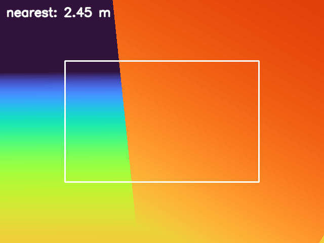

*The frame that stopped the vehicle. The white box is the ROI allowed to command
a stop; the wall is the orange region at 2.4 m.*

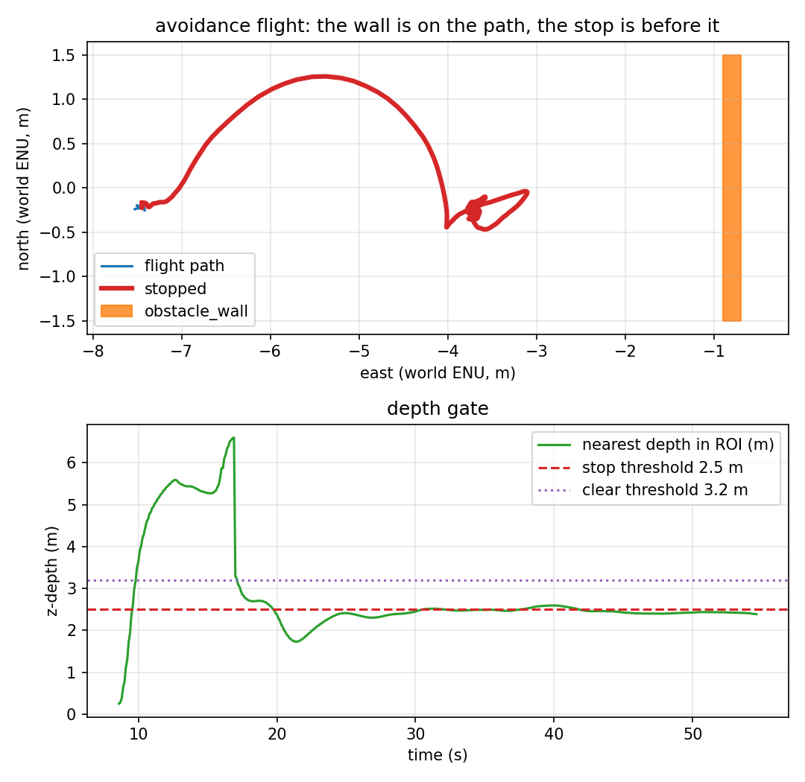

*Top: the wall (orange) sits between the spawn and the target; red is the held
interval. Bottom: the ROI's nearest z-depth crosses 2.5 m and never reaches the
3.2 m release threshold again.*

The honest limits — static wall, ideal simulated depth, no path planning, one run
at 0.6 m/s — are in [`docs/avoidance.md`](docs/avoidance.md).

### Going around it: an L-shaped detour

Phase 2 is the smallest useful "go around": one fixed side, one L, one static
wall. The vehicle stops at the wall, flies **3.5 m right**, then **5 m forward**
past the wall's east face, and resumes `target_0` once the depth gate has been
clear for a second. A diagonal back to the target would cut the wall's corner;
the forward leg is why this is an L.

One `make detour` run: stop at 20.2 s, 3.394 m lateral leg, gate released at
29.8 s, final target error **0.527 m** (landing row 0.63 m, `success=True`),
minimum wall clearance **0.999 m**, **0** contacts, 791 depth frames. The report
passes eight checks.

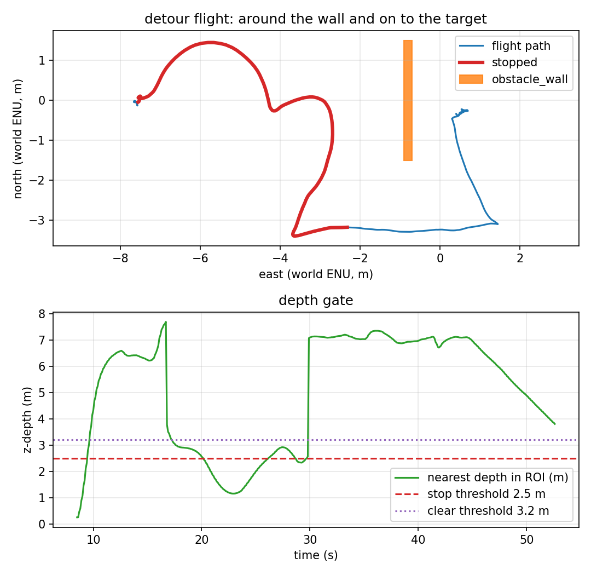

*The stop is red (the gate is still set while the vehicle escapes sideways), the
lateral and forward legs are the L, and the final approach reaches the target.*

Limits: fixed side, one obstacle, no map, no dynamic obstacle, one run at
0.6 m/s; the first 3 m forward leg grazed the wall's corner and was too short.
See [`docs/detour.md`](docs/detour.md).

### Choosing the side

Phase 3 replaces the constant side with a measurement: the depth node compares
the nearest return in the **left 20%** and **right 20%** strips (outside the
centre ROI), applies a 0.5 m margin, and publishes `/avoidance/clear_side`. The
planner uses that choice at the first stopped tick; `detour_side` remains the
fallback.

`make auto-detour` uses a third world with a 6 m pillar in the right strip. One
run: stop at 18.5 s, **side at the stop = left**, 4.181 m lateral leg, gate
released at 22.7 s, final target error **0.714 m** (landing row 0.591 m,
`success=True`), minimum clearance **0.688 m**, **0** contacts on both the wall
and the pillar, 790 depth frames.

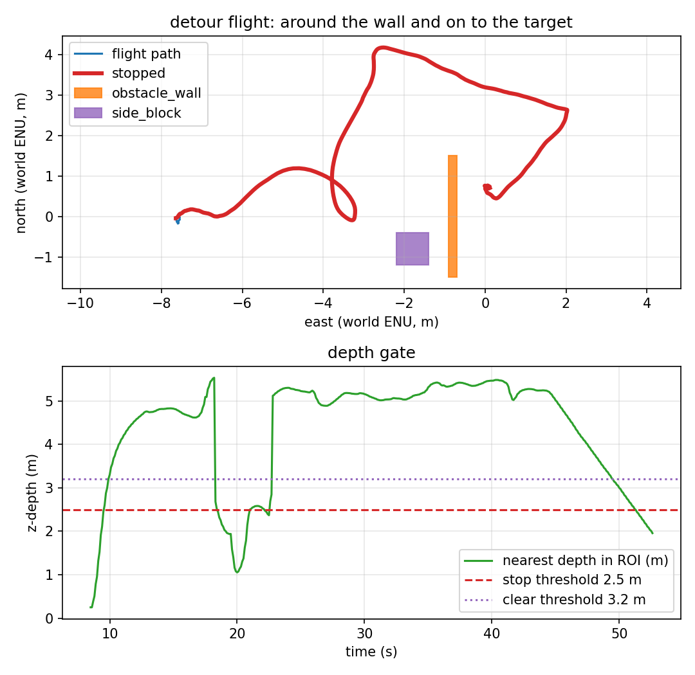

*The right strip sees the pillar; the left strip is freer, so the L goes north.*

Limits: two strips, one decision per stop, no memory, no re-planning, one
obstacle. See [`docs/side-selection.md`](docs/side-selection.md).

### When both sides are blocked

Phase 4 is the refusal: if both strips are inside the clearance floor, the depth
node publishes `blocked`, the controller **holds** and does not pick the
less-bad side. It latches `blocked` for the rest of the stop (the label can
flicker as the vehicle pitches) and waits `detour_start_delay_s` before
committing, so a transient `left` frame cannot start a detour.

`make blocked` puts a 4 m barrier across the path and uses a 3.0 m floor. One
run: stop at 19.6 s, **held 35.0 s**, settled drift **0.129 m**, minimum wall
clearance **2.68 m**, **0** contacts on the wall and the barrier, 821 depth
frames. The mission then times out and lands 4.032 m from target_0
(`success=False`): the refusal is the point, not the delivery.

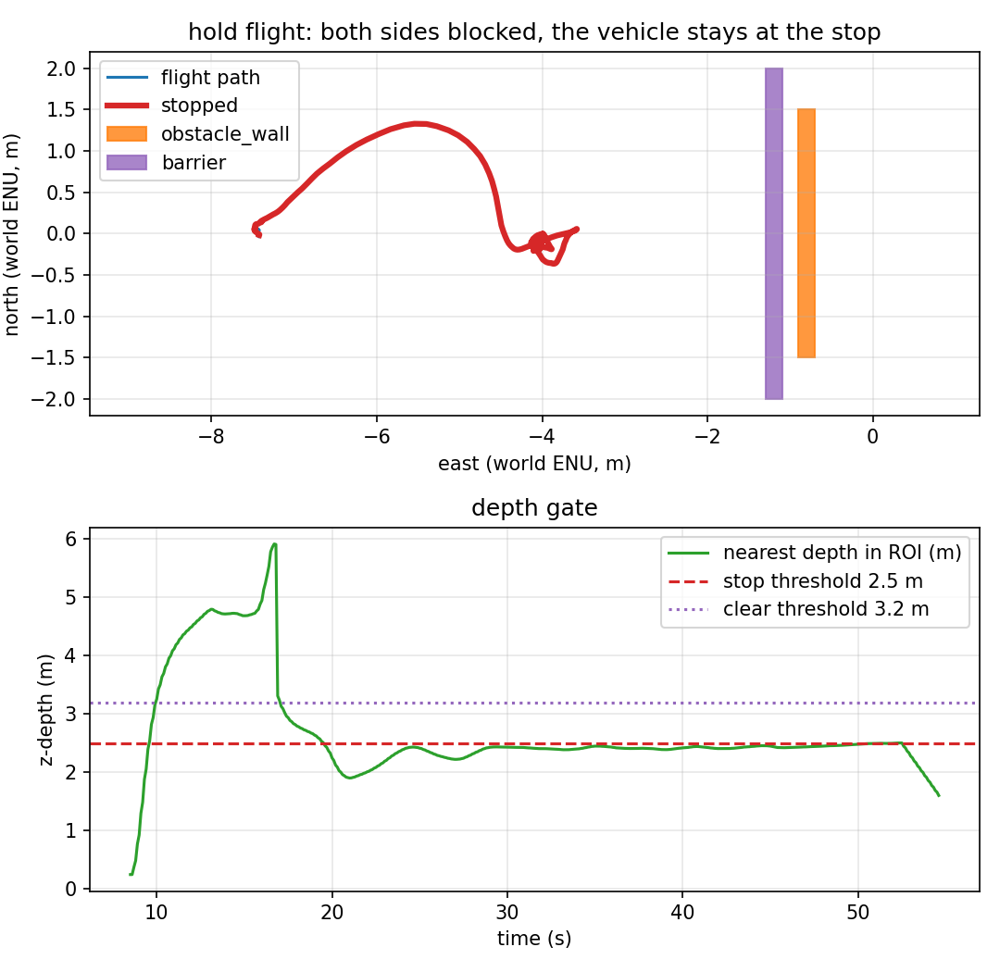

Limits: no backing off or searching for another gap, no path when both sides are
blocked; it holds and lands. See [`docs/blocked.md`](docs/blocked.md).

### Backing off to recover

Phase 5 adds one recovery move. When both strips are blocked, the planner backs
straight away from the obstacle by `backoff_m` (2.0 m), re-reads the strips, and
starts the L from there if a side is free; if not, it holds and does not repeat.

`make backoff` uses the blocked world with a 4.0 m side floor. One run: stop at
19.7 s, **backed off 1.63 m** (2.0 m waypoint, 0.5 m tolerance), **left** side at
the back-off point, 3.254 m lateral leg, 7 m forward, final target error
**0.831 m** (landing 0.684 m, `success=True`), minimum clearance **0.595 m**,
**0** contacts, 882 depth frames, 58.6 s.

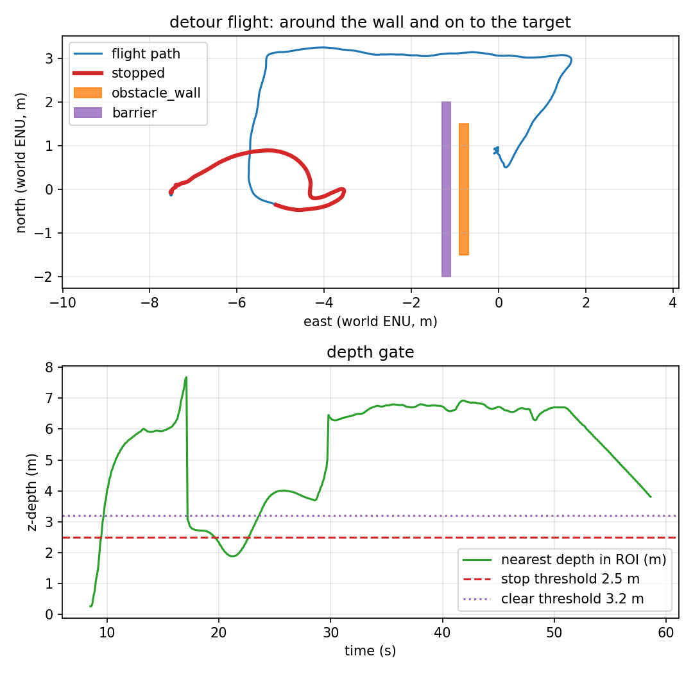

*The red segment is the stop plus the back-off; the blue L goes around the
barrier's north end.*

Limits: one fixed back-off distance, one retry, no search loop, one static
barrier; if no side clears it holds. See [`docs/backoff.md`](docs/backoff.md).

### Repeating the back-off

Phase 6 repeats that step until a budget is spent (`backoff_max_attempts`), making
a fresh side decision at each new position. `make backoff-sweep` uses 0.2 m steps
and a 6.0 m side floor, so the barrier's strips stay blocked for several steps.

One run: stop at 17.9 s, **four back-off attempts** (`2/4` … `4/4` in the trace),
**0.62 m** of back-off travel, **left** at the last step, 3.772 m lateral leg,
6 m forward, final target error **0.852 m** (landing 0.808 m, `success=True`),
minimum clearance **0.639 m**, **0** contacts, 1212 depth frames, 80.6 s.

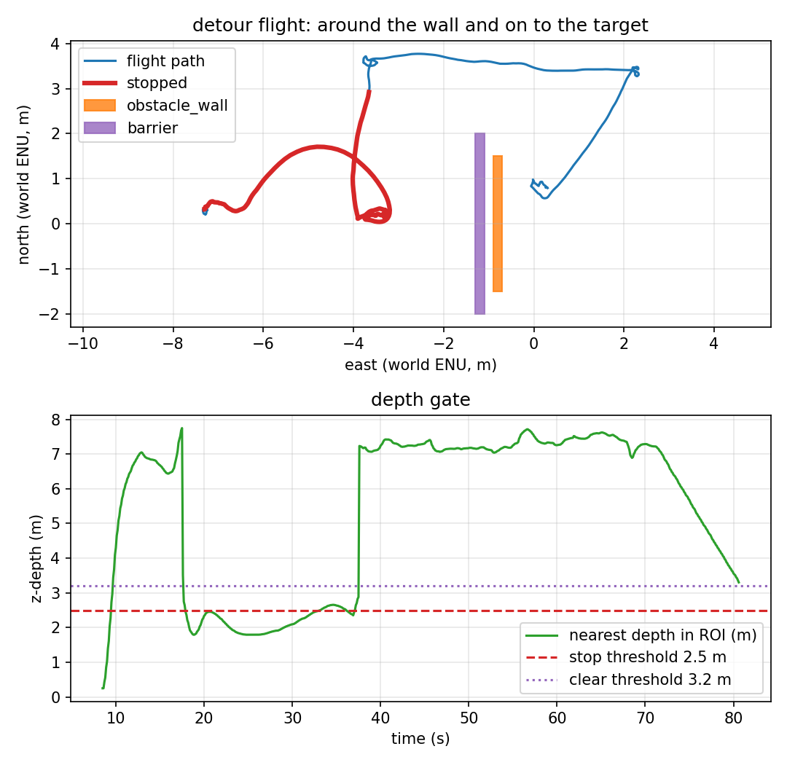

Limits: fixed 0.2 m step straight back, budget 4, no adaptive distance or
sideways sweep; if the budget runs out it holds. See
[`docs/backoff-sweep.md`](docs/backoff-sweep.md).

### Sizing the back-off from the measurement

Phase 7 publishes the two strip distances (`/avoidance/side_clearance`) and sizes
the retreat: `clamp(target − max(left, right), 0.2, 2.0)`. With `backoff_m: 0.0`
there is no fixed distance at all; without a measured step it would hold.

One run: stop at 18.9 s, side clearances **left 3.20 m / right 2.32 m**, computed
step **2.00 m**, 2.02 m of travel, **left** after it, 3.566 m lateral leg, 7.5 m
forward, final target error **0.618 m** (landing 0.572 m, `success=True`),
minimum clearance **0.47 m**, **0** contacts, 1001 depth frames, 66.6 s.

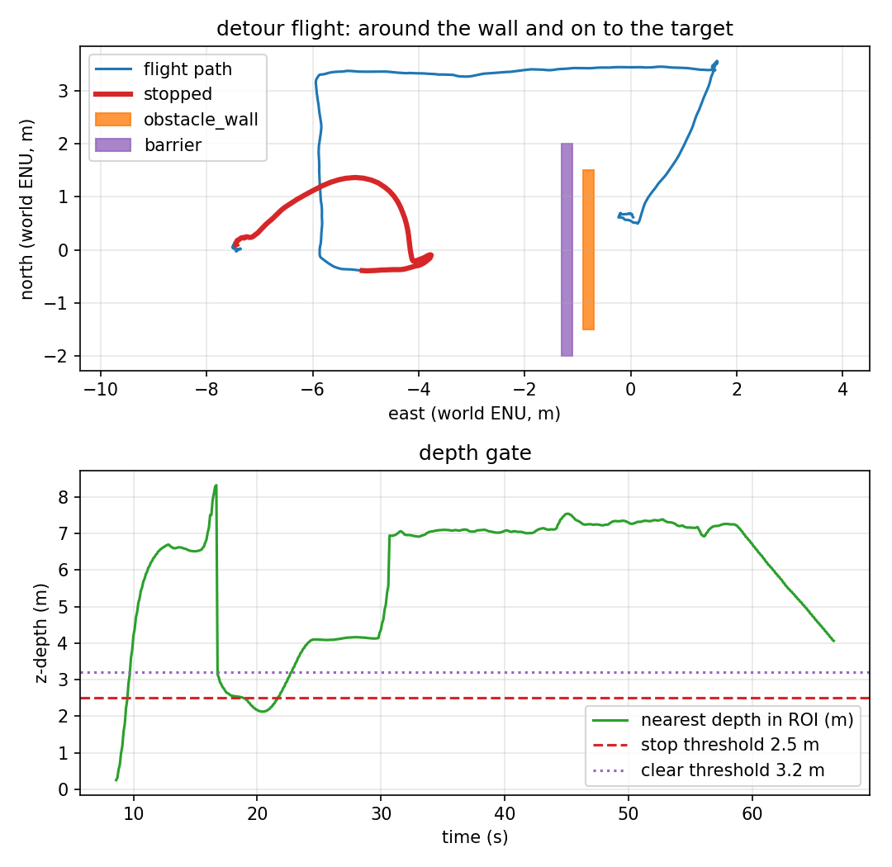

Limits: one measured step was enough in this run; a second adaptive step is
unit-tested only, the direction is still straight back, and one static barrier.
See [`docs/adaptive.md`](docs/adaptive.md).

### Side-stepping after a blocked stop

Phase 8 adds the other local degree of freedom: when a stop is still blocked,
shift sideways 2 m toward the freer side, re-read the strips, and start the L
from there. `make search` uses a wall with two 6 m side pillars.

One run: stop at 17.9 s, **every stopped row is `blocked`** (L 2.75 / R 1.91),
**`side-search left` → `search found a side`**, 1.93 m search step, 3.36 m
lateral leg, final target error **0.669 m** (landing 0.663 m, `success=True`),
minimum clearance **0.869 m**, **0** contacts, 1177 depth frames, 78.4 s.

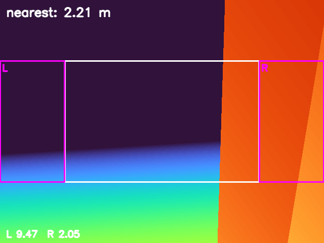

This is the clean version: both strips are below the 4.0 m floor on the stopped
rows, not only during the search.

Limits: one side, fixed 2 m step, bounded attempts; no alternating/2-D search;
one static two-pillar world. See [`docs/search.md`](docs/search.md).

### Known-map global planning

Phase 9 is the other half of the question: with a map of the wall, plan the path
before flying. A 2-D grid A* with line-of-sight smoothing reads
`global_obstacles` from the mission and the offboard follows the planned
waypoints.

`make global` plans to a stand-off 0.7 m east of target_0 (target_0 itself is
only 0.7 m from the wall face; landing exactly on it put the props inside the
wall contact envelope). One run: **3 waypoints** around the wall, final target
error **0.24 m**, landing 0.216 m `success=True`, minimum clearance **0.554 m**,
**0** contacts, 640 depth frames, 42.5 s. The reactive stop is disabled for this
mission (`avoidance_stop_enabled: false`); the red gate flag in the plot is not a
hold.

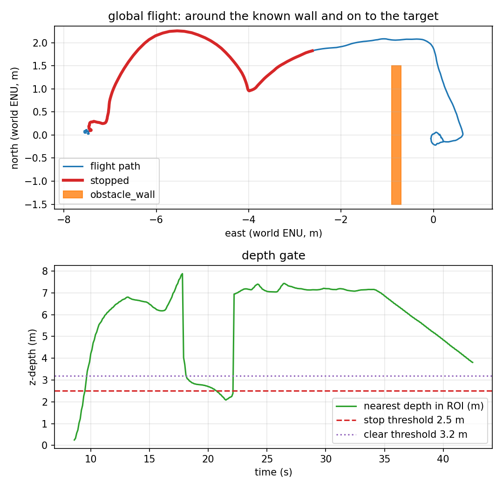

Limits: hand-entered static axis-aligned boxes, one plan per goal, no perception
in the planner, no replanning/dynamic or 3-D obstacles. See
[`docs/global.md`](docs/global.md).

`make global-multi` gives the same planner three boxes (wall + both search
pillars). One run: **3 waypoints around 3 obstacles**, target **0.616 m**,
landing 1.001 m `success=True`, minimum clearance **0.959 m**, **0** contacts,
686 depth frames, 46.2 s.

### Perception-to-planning

`make global-perception` starts with an **empty map**. The vehicle flies the
straight plan, the depth gate stops on the wall at **2.46 m**, and that measured
range plus pose becomes one conservative box `(6.57, 0.17)`, `0.40 × 4.00 m`.
The planner then makes **3 waypoints around 1 obstacle**; the reactive stop is
ignored after the handoff.

One run: target **0.777 m**, landing **1.13 m** `success=True`, minimum clearance
**0.732 m**, **0** contacts, 698 depth frames, 46.4 s. This is one range and one
replan, not an occupancy map.

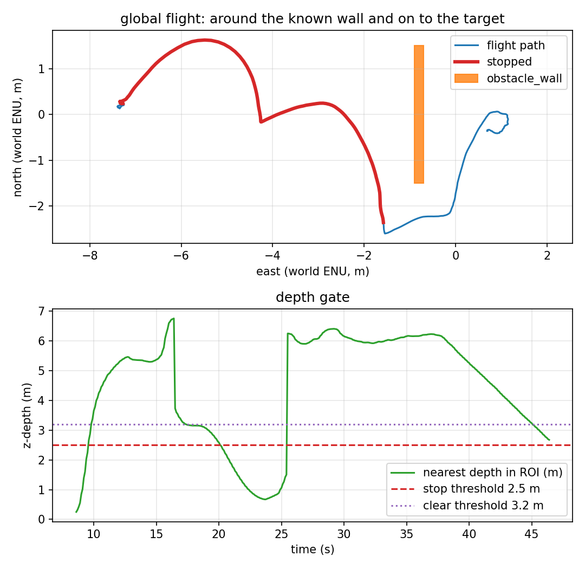

Limits: one-shot box, conservative 4 m width, no map accumulation, no replanning
after the handoff, no dynamic/3-D obstacles. See
[`docs/perception-planning.md`](docs/perception-planning.md).

### Rotated obstacle

`Box` now takes a fifth field, `angle_rad`; `contains()` rotates the query point
into the box frame, so the same grid A* handles a wall rotated about z.

`make global-rotated` uses a 30° wall: **2 waypoints around 1 obstacle**, target
**0.218 m**, landing **0.391 m** `success=True`, exact rotated clearance
**0.509 m**, **0** contacts, 580 depth frames, 42.6 s. The report measures the
rotated shape, not an axis-aligned bound.

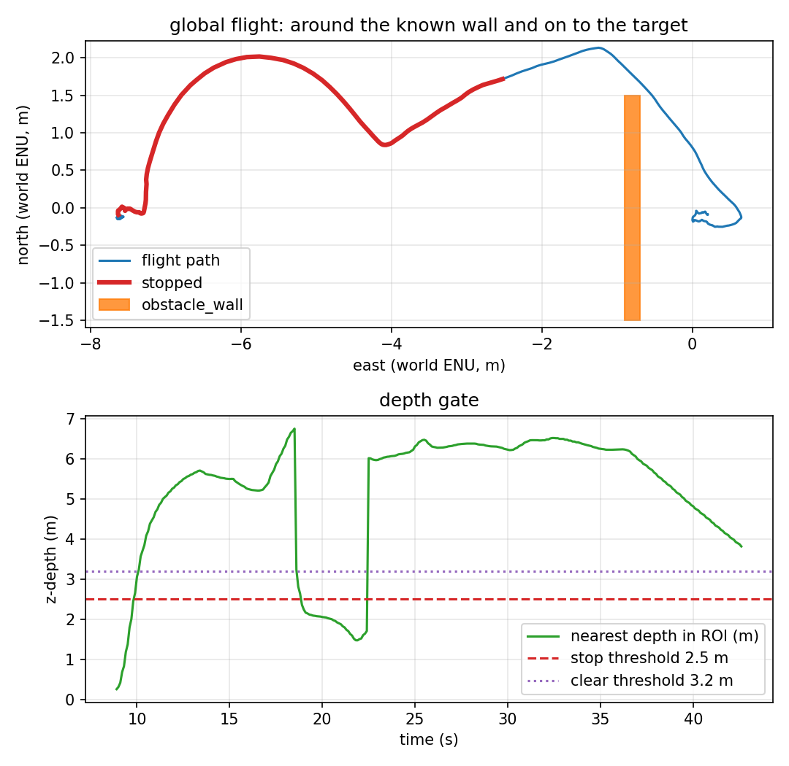

Limits: one static rotated box, hand-entered, constant altitude; no multiple
rotated boxes, 3-D obstacles or perception. See
[`docs/rotated.md`](docs/rotated.md).

`make global-rotated-multi` gives the planner two rotated boxes (the 30° wall and
a 45° pillar): **3 waypoints around 2 obstacles**, target **0.586 m**, landing
**0.439 m** `success=True`, clearance **0.698 m**, **0** contacts on either
sensor, 664 depth frames, 43.6 s.

### Through the doorway

`make gate` replaces the solid wall with two segments and a **2.4 m doorway**,
then lands on target_0 itself instead of a stand-off: **1 waypoint through the
gap**, target **0.49 m**, landing **0.275 m** `success=True`, clearance
**1.17 m**, **0** contacts on either segment, 639 depth frames, 42.4 s.

`make gate-target1` is the offset version: gate at x = 9.2 with the gap centred at
y = 2.4, target_1 far east at (20, 0). The planner makes **3 waypoints** through
the gap, then turns to target_1: target **0.277 m**, landing **0.425 m**
`success=True`, clearance **0.42 m**, **0** contacts, 822 depth frames, 62.4 s.
The report measures target_1 (`--target-id 1`).

`make gate-double` chains two gates: gate 1 at x = 1.2 with a north gap, gate 2 at
x = 12.2 with a south gap, target_1 at (20, 0). The planner makes **5 waypoints
around 4 segments**: target **0.082 m**, landing **0.404 m** target 1
`success=True`, clearance **0.45 m**, **0** contacts, 934 depth frames, 74.5 s.

### Repeatability

The acceptance suite is **20 runs per scenario**; `make repeat5` is only a quick
sample, not evidence. The final table is:

| Scenario | PASS | Target error mean (m) | Clearance min (m) | Contacts |
|---|---:|---:|---:|---:|
| gate (old 0.5/0.2, target_0) | **17/20** | 0.551 | 0.307 | **59** |
| gate-double (old 0.8/0.1) | **15/20** | 0.612 | 0.265 | **5** |
| **gate-safe (stand-off, 0.8/0.05)** | **20/20** | 0.331 | 0.787 | 0 |
| **double-safe (1.0/0.05, 100 s)** | **20/20** | 0.226 | 0.781 | 0 |
| gate-target1, original 0.5 m / 0.2 m | **0/3** | 0.393 | 0.018 | 4 |
| gate-target1, fixed 0.8 m / 0.1 m | **9/10** | 0.287 | 0.667 | 1 |
| gate-target1, margin 1.0 m / 0.05 m, 70 s | **16/20** | 1.191 | 0.469 | **186** |
| gate-target1, margin + 100 s budget | **20/20 landings / 19/20 final-row** | 0.461 | 0.756 | 0 |

The first gate 5/5 and gate-double 5/5 were **small-sample illusions**: at n=20
they are 17/20 with 59 contacts and 15/20 with 5 contacts. The retained safe
configurations fix them both:

- **gate-safe**: goal is an east stand-off at local 8.2 m (target_0 within 0.7 m),
  0.8 m inflation, 0.05 m waypoint tolerance, 80 s budget: **20/20, 0 contacts**,
  clearance min 0.787 m, target error max 0.751 m.
- **double-safe**: 1.0 m inflation, 0.05 m waypoint tolerance, 100 s budget:
  **20/20, 0 contacts**, clearance min 0.781 m, target error max 0.351 m.

The target1 100 s budget is also **20/20 landings, 0 contacts**, with one
post-landing final-row drift (run 16 landed at 0.285 m, final row 2.149 m). See
[`docs/repeatability.md`](docs/repeatability.md).

### Offline depth-map gate

`make map-gate` projects a **recorded** depth frame (search frame, explicit pose
row 215) into local ENU and checks it against the three known search boxes.

- **Point projection PASS**: 83.4% within 1 m, median 0.339 m; the opposite
  camera sign gives 55.6% and was the bug behind the failed occupancy attempts.
- **Occupancy grid FAIL**: 174 cells, precision **0.678** (<0.80); 32% are
  sparse outliers that the component filter does not remove. no map SITL run is
  attempted.

This is a projection/quality gate, not a map planner. See
[`docs/map-gate.md`](docs/map-gate.md).

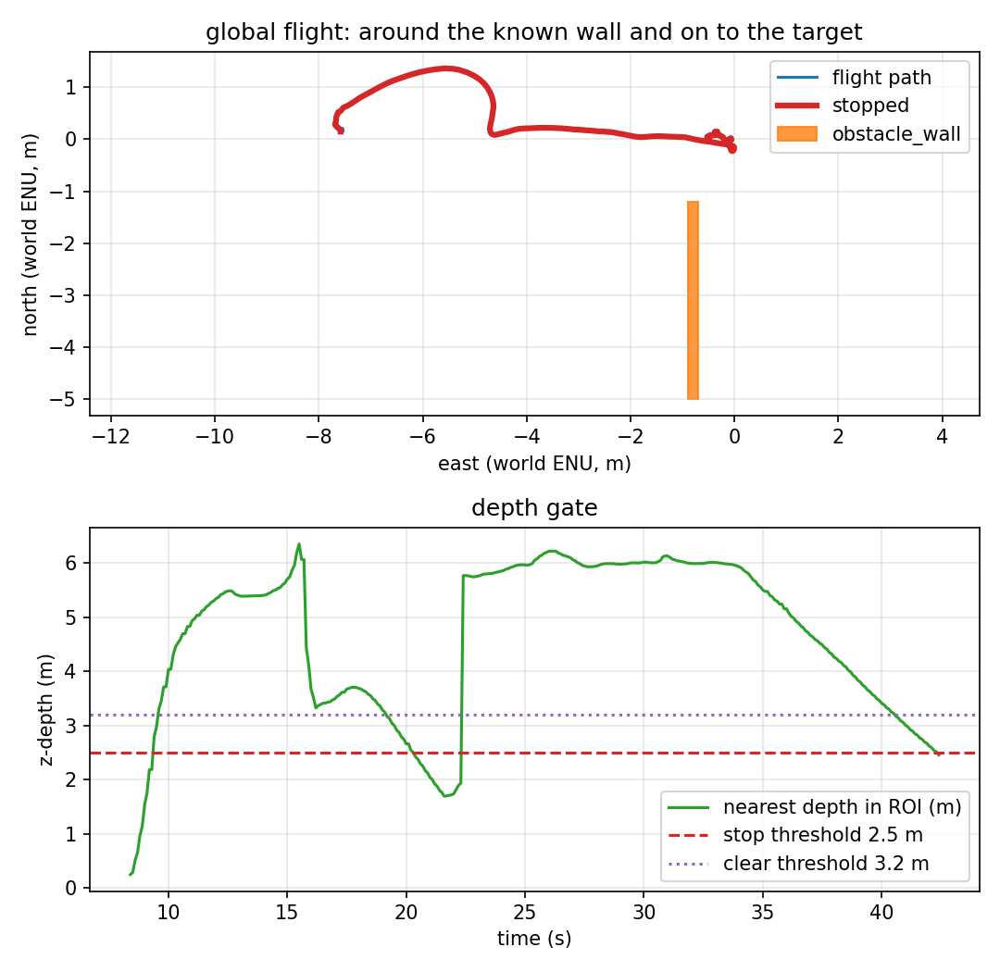

Limits: one aligned 2.4 m doorway, hand-entered; no narrower/cluttered doorway,
turn inside the gap, 3-D or perception. See [`docs/gate.md`](docs/gate.md).

**Version provenance.** The table is the nine-trial set measured with **v0.1.0**.
v0.2.0 changes safety behaviour only — a geofence, a mission timeout and a
requirement that a target be seen for consecutive frames before the mission acts
on it. Three further runs with that code measured 0.94 m, 1.01 m and 1.49 m, all
within tolerance ([`results/v02_validation.csv`](results/v02_validation.csv)).
One run during that validation missed by 5.6 m because a single frame during the
search was believed; that is what `confirm_frames` exists for, and why the three
rows above are a verification rather than a replacement of the nine.

Hardware: Intel i7-14650HX (24 threads), 32 GB RAM, no discrete GPU in the VM —
Gazebo rendered headless through WSL2.

## What is verified, and what is not

| Layer | Status | Evidence |
|---|---|---|
| Geometry, frame conversions, mission logic, recorder | ✅ verified | `pytest` (442 tests) + `make demo` || YOLO letterbox / decode / NMS | ✅ verified | `tests/test_yolo.py` (13 tests) |
| Cross-frame identity (`track_id`) | ✅ verified | `tests/test_tracking.py` (12 tests) + a ROS test that the id survives two frames |
| ROS 2 packages build, both nodes run | ✅ verified in CI | `ROS build` workflow on `ros:humble`: detector against synthetic images, controller against fake PX4 traffic |
| Version matrix, world structure, camera intrinsics | ✅ checked | `make doctor`, `check_world_targets.py` in CI |
| Closed loop in Gazebo SITL | ✅ **verified** | 9/9 trials, median 0.73 m, p50 143 ms; [`results/landing_error.csv`](results/landing_error.csv) |
| YOLO backend in the same loop | ✅ **verified** | 6/6 trials within tolerance, median 1.15 m; [`results/v05_yolo_real.csv`](results/v05_yolo_real.csv) |
| Detector throughput | ✅ measured on CPU | 119 FPS at 320 px / 4 threads, 37 FPS at 640 px; [`docs/deployment.md`](docs/deployment.md) |
| Was it deployed on a Jetson | ❌ **not yet** | no board; TensorRT and INT8 are the honest gaps, [`docs/market.md`](docs/market.md) |
| Multi-target patrol | ✅ **verified** | two waypoints 20 m apart, landed 0.438 m from the second; [`results/v06_patrol.csv`](results/v06_patrol.csv) |
| Moving targets | ✅ **one recorded flight** | cube moved 3 m at 0.5 m/s; the tracker held one id across 88 detections. Plain IoU was enough at that speed — the motion model's unit tests define when it is not; [`results/v07_moving_target.txt`](results/v07_moving_target.txt) |
| Depth camera publishes real depth | ✅ **verified** | 640×480 `R_FLOAT32` frames, 822 bridged in 54.6 s; the stopped frame and its `.npy` are in [`results/avoidance_depth_frame.png`](results/avoidance_depth_frame.png) |
| Reactive stop before an obstacle | ✅ **verified** | stop at 19.8 s, held 25.1 s, settled drift 0.124 m, min clearance 2.204 m, 0 contacts; [`results/avoidance_summary.json`](results/avoidance_summary.json) |
| Reactive L-shaped detour | ✅ **verified** | 3.394 m lateral, gate released, target reached 0.527 m, min clearance 0.999 m, 0 contacts; [`results/detour_summary.json`](results/detour_summary.json) |
| Depth-based choice of detour side | ✅ **verified** | `clear_side_at_stop=left`, 4.181 m lateral, target 0.714 m, 0 contacts; [`results/autod_summary.json`](results/autod_summary.json) |
| Both sides blocked → hold, not guess | ✅ **verified** | `blocked` label latched, 35.0 s hold, 0.129 m settled drift, 0 contacts, mission timeout lands at 4.032 m (`success=False`, expected); [`results/blocked_summary.json`](results/blocked_summary.json) |
| Both sides blocked → back off and recover | ✅ **verified** | 1.63 m back-off, left side at the back-off point, 3.254 m lateral, target 0.831 m, 0 contacts; [`results/backoff_summary.json`](results/backoff_summary.json) |
| Both sides blocked → repeat the back-off | ✅ **verified** | four 0.2 m steps, left at the last step, 3.772 m lateral, target 0.852 m, 0 contacts; [`results/sweep_summary.json`](results/sweep_summary.json) |
| Both sides blocked → size the back-off from depth | ✅ **verified** | left 3.20 / right 2.32 m at the stop → computed 2.00 m step, target 0.618 m, 0 contacts; [`results/adaptive_summary.json`](results/adaptive_summary.json) |
| Side-step search recovery after a blocked stop | ✅ **verified** | every stopped row `blocked` (L2.75/R1.91), `side-search left` → `search found a side`, target 0.669 m, landing 0.663 m, 0 contacts; [`results/search_summary.json`](results/search_summary.json) |
| Known-map global path around the wall | ✅ **verified (known map)** | 3 waypoints, target 0.24 m, landing 0.216 m, clearance 0.554 m, 0 contacts; reactive stop disabled; [`results/global_summary.json`](results/global_summary.json) |
| Multi-obstacle known-map path | ✅ **verified (known map)** | 3 waypoints around 3 boxes, target 0.616 m, landing 1.001 m, clearance 0.959 m, 0 contacts; [`results/global_multi_summary.json`](results/global_multi_summary.json) |
| Depth stop → box → replan | ✅ **verified (one-shot)** | empty initial map, 2.46 m stop → box `(6.57, 0.17)`, 3-waypoint replan, target 0.777 m, 0 contacts; [`results/global_perception_summary.json`](results/global_perception_summary.json) |
| Rotated-box known-map path | ✅ **verified (one static box)** | 30° wall, 2 waypoints, target 0.218 m, landing 0.391 m, exact clearance 0.509 m, 0 contacts; [`results/global_rotated_summary.json`](results/global_rotated_summary.json) |
| Two rotated obstacles | ✅ **verified (two static boxes)** | 3 waypoints, target 0.586 m, landing 0.439 m, clearance 0.698 m, 0 contacts on wall and pillar; [`results/global_rotated_multi_summary.json`](results/global_rotated_multi_summary.json) |
| Doorway traversal and target landing | ✅ **20/20, 0 contacts (gate-safe)** | stand-off 8.2 m, 0.8/0.05; target_0 error max 0.751 m, clearance min 0.787 m; [`results/repeat_report.md`](results/repeat_report.md) |
| Offset doorway, then turn to target_1 | ✅ **20/20 landings; 19/20 final-row** | 100 s budget: landings 20/20, 0 contacts; one final-row 2.149 m drift after a 0.285 m landing; 70 s was 16/20; [`results/repeat_report.md`](results/repeat_report.md) |
| Two doorways, then target_1 | ✅ **20/20, 0 contacts (double-safe)** | 1.0/0.05, 100 s; target 0.226 m mean, clearance min 0.781 m; [`results/repeat_report.md`](results/repeat_report.md) |
| Offline depth-map projection gate | ⚠️ **points PASS; grid FAIL** | 1080 points, 83.4% within 1 m; 174 cells, precision 0.678 <0.80; [`results/map_gate.md`](results/map_gate.md) |
| Contact sensor can report a contact | ✅ **checked positively** | a 0.5 kg box dropped on the wall produced 4632 messages; [`results/contact_sensor_check.txt`](results/contact_sensor_check.txt) |
| Depth-sensor noise, holes, real hardware | ❌ **not verified** | Gazebo returns ideal float32 depth; there is no real depth camera, no multipath, no missing-return model |
| Dynamic obstacles / global planning | ❌ **not implemented** | local stop + one detour + one hold; no obstacle track, no global planner |
| PX4 change needed for those trials | ✅ documented and patchable | [`patches/px4-v1.15-gz-magnetometer.patch`](patches/px4-v1.15-gz-magnetometer.patch) + `make patch-px4`; unpatched PX4 will not arm |

The ❌ rows are the honest gaps: no Jetson deployment, no real depth sensor and
no dynamic-obstacle planning. Every ✅ row links to the file that produced it;
what each was checked against — including the four defects the check found — is
in [`docs/verification-log.md`](docs/verification-log.md).

## Skills

Every problem this stack produced, written up as a short procedure with a
verification step — not a blog post, not folklore:

| | |
|---|---|
| [01](skills/01-silent-topic.md) | A topic that publishes and a node that receives nothing (QoS) |
| [02](skills/02-camera-mount.md) | Telling a nadir camera from a forward one |
| [03](skills/03-world-plugins.md) | Making a PX4 world load its systems |
| [04](skills/04-intrinsics-from-sdf.md) | Deriving intrinsics from the model file |
| [05](skills/05-version-drift.md) | Pinning `px4_msgs` against `px4_ros_com` |
| [06](skills/06-numpy-abi.md) | The numpy 2 / `cv_bridge` segfault |
| [07](skills/07-claim-to-csv.md) | Turning a run into a number you can defend |

Index and rationale: [`skills/README.md`](skills/README.md).

To point all of this at your own target, camera or scene, follow
[`docs/adoption.md`](docs/adoption.md) — it lists what to change and the check
that proves each change worked. To read the code instead, start with
[`docs/review-guide.md`](docs/review-guide.md): one guarantee per module, with the
test that would fail if it broke.

## Stack

| Layer | Component | Version |
|---|---|---|
| Flight stack | PX4 SITL, model `x500_mono_cam_down` | v1.15.x |
| Simulator | Gazebo Harmonic (`gz sim`) | gz-sim 8 |
| Middleware | ROS 2 Humble + uXRCE-DDS (`px4_msgs`) | Humble |
| Perception | YOLO11n → ONNX Runtime (CPU), or HSV baseline | ORT ≥ 1.17 |
| Camera | 1280×960, HFOV 1.74 rad, nadir (fx = 538.4) | from the PX4 model |
| Depth camera | 640×480, `R_FLOAT32`, 30° down-tilt, 15 Hz | `sim/models/x500_mono_cam_down` |
| Language | Python 3.10 / C++17 | — |

## Architecture

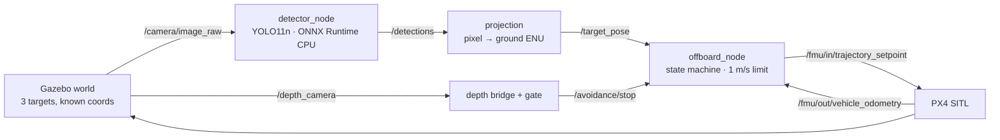

Details: [`docs/architecture.md`](docs/architecture.md) (frame conventions, topic contract, state machine).

## Quick start

Verified on **Ubuntu 22.04 + ROS 2 Humble**. Windows/macOS are not supported for the simulator.

```bash
git clone https://github.com/wuuu854-boop/uav-yolo-offboard-tracking.git && cd uav-yolo-offboard-tracking
bash scripts/setup.sh          # 检查环境 + 建 venv + 装依赖（不会自动 sudo apt）
cp .env.example .env           # 填 PX4_DIR 等本地路径
source .venv/bin/activate
colcon build --packages-select uav_interfaces && source install/setup.bash
make doctor                    # 六项环境检查，失败时直接给修复命令
make patch-px4                 # PX4 v1.15 缺磁力计回调；打补丁并重编译
make sim                       # 起 Gazebo + PX4 SITL（终端 A）
make preflight                 # 不开仿真，先查配置/依赖/目录是否齐备
make detect                    # 只跑检测节点，验证 /detections 有输出（终端 B）
make e2e                       # 闭环：起飞 → 检测 → 抵近 → 悬停 → 降落
make avoid                     # 深度相机：起飞 → 在墙前停住 → 降落（证据写入 results/）
make detour                    # 深度相机：停住 → 固定右侧 L 形绕墙 → 回到目标
make auto-detour               # 深度相机：左右条带选较空的一侧 → L 形绕墙 → 回到目标
make blocked                   # 深度相机：两侧都堵 → 保持不动，不猜方向（任务超时降落）
make backoff                   # 深度相机：两侧都堵 → 后退 2 m 重看 → 选边绕行
make backoff-sweep             # 深度相机：一次后退不够 → 0.2 m 步进重看，直到有空侧
make adaptive                  # 深度相机：按左右实测距离计算后退量，再选边绕行
make search                    # 深度相机：停住后侧移 2 m 重看，找到空侧再绕行
make global                    # 已知地图 A*：先规划绕墙路径，再飞（关闭反应式停障）
make global-multi              # 已知地图 A*：墙 + 两根侧柱的多障碍路径
make global-perception         # 深度停障 → 一个实测障碍框 → 重规划绕过
make global-rotated            # 已知地图 A*：绕 30° 旋转墙
make global-rotated-multi      # 已知地图 A*：绕旋转墙 + 45° 旋转柱
make gate                      # 穿 2.4 m 门洞并降落在 target_0 上
make gate-target1              # 偏置门洞穿过后转弯飞向 target_1
make gate-double               # 连续两个偏置门洞，再转弯飞向 target_1
make repeat                    # gate / gate-target1 / gate-double 各重复 3 次
make repeat5                   # 三个门洞任务各重复 5 次
make repeat-target1-10         # 保留的 gate-target1 配置重复 10 次
make repeat-target1-20         # 同一配置重复 20 次（当前验收样本）
make map-gate                  # 离线深度帧投影质量门禁（不飞）
```

> **Windows 用户**：PX4 SITL 只能跑在 Linux 上。用 WSL2 + Ubuntu 22.04（Windows 11
> 自带 WSLg，Gazebo 图形界面可用）或双系统。WSL2 下 Gazebo 帧率通常偏低：如果
> `ros2 topic hz /camera/image_raw` 达不到 15 Hz，先查 WSL 的 GPU 加速，而不是改代码。

### No Linux yet? Check the logic in ten seconds

```bash
python3 scripts/offline_demo.py     # or: make demo
```

Runs the real `projection.py` and `state_machine.py` against a synthetic camera
and a point-mass vehicle: takeoff → detect → approach → hover → land. It writes
`results/offline_demo.csv` and a two-panel plot.

It validates **geometry and mission logic only** — no dynamics, no perception
failure, not a result. The numbers that belong in the table come from SITL.


*Produced by `make demo`: takeoff to 10 m, approach, hover, land. The title
reports the final error of that run.*

## Reproduce

```bash
bash scripts/download_data.sh  # 校验本地模型权重与样例数据（权重不随仓库分发）
make e2e
make bench                     # results/landing_error.csv -> README 结果表
```

## Repository layout

```
src/uav_tracking/perception/   YOLO ONNX 检测节点、像素→地面投影（纯函数，有单测）、颜色基线、深度图统计与停障门（纯函数，有单测）
src/uav_tracking/control/      NED↔ENU 帧转换、任务状态机（纯 Python，有单测）、Offboard 节点、目标选择、实验记录器
src/uav_interfaces/  自定义 Target / TargetArray 消息
sim/              Gazebo world（3 个已知坐标目标；带 6 m 障碍墙的避障 world）与深度相机模型
config/           相机内参、检测参数、任务参数、目标真值、深度阈值与障碍几何
scripts/          doctor.py（环境诊断）、benchmark.py（结果汇总）、setup / e2e / avoid / 深度桥与避障报告
results/          实验原始数据（CSV），README 中每个数字的来源
docs/             坐标约定、实验协议、先例分析、故障排查、场景预算、AI 使用记录（索引：[docs/README.md](docs/README.md)）
```

## Results & failure analysis

Three things the nine trials settled:

- **The loop closes on its own.** Nine of nine landed within 1.5 m, median
  0.73 m, with no operator input beyond starting the run. The trace for every
  trial shows the same shape: arm → climb → approach → hover 3 s → land.
- **The two failures were in the measurement, not the flight.** The first four
  runs scored 2.4–3.5 m because the recorder compared PX4's local frame with
  world ground truth; the next four lost ~0.8 m to a stale hover setpoint. Both
  are visible in `results/state_trace.csv` before they are visible in the error.
- **Latency does not drive the error.** At p50 143 ms the vehicle moves 0.14 m
  between frame and setpoint at 1 m/s, which is inside the reach tolerance of
  1.0 m. The spread in landing error tracks detection jitter, not delay.

Failure modes this system actually produced, each with the check that catches it:

- **Target lost mid-approach** → hover 2 s, then a lawnmower search; the trace
  shows `GOTO → HOVER(target_lost) → SEARCH → GOTO(target reacquired)`. That
  path ran in the target-1 trials before the colour ranges were fixed, and it is
  why the vehicle did not simply hover forever.
- **Wrong frame, right flight** → every error was exactly the spawn offset.
  `localise_targets()` plus two unit tests make the frame conversion explicit
  instead of implicit.
- **Stale setpoint on arrival** → arrival and landing positions differed by
  0.5–0.9 m in all traces; hover now commands the current position.

## Limitations

- **仅 SITL 仿真，没有真机飞行。** 不写"实飞验证"。
- 推理在 x86 CPU 上完成，**未在 Jetson / RK3588 上实测**。
- 假设目标静止、地面水平、相机严格下视；roll/pitch 未补偿。
- 单目标；多目标跟踪属于 v0.2.0 范围。
- 搜索是固定方形草坪扫描（20 m、间距 8.9 m），不含重规划，也不覆盖大面积区域。
- 避障验证了「停住」、固定右侧 L 形绕墙、用左右深度条带选择绕行方向、两侧都堵时
  拒绝猜方向并保持、后退重看、0.2 m 步进重复后退、按实测距离计算后退量，以及停住后
  侧移 2 m 重新读条带并恢复、已知地图 A* 单/多障碍绕墙、30° 旋转墙与双旋转障碍、
  2.4 m 门洞降落 target_0、偏置门洞转弯降落 target_1、连续双门洞转弯降落 target_1，
  以及 20× 重复性验证（gate-safe 20/20、double-safe 20/20，均 0 接触；
  旧 gate/gate-double 配置为 17/20、15/20；gate-target1 20/20 降落、最终行 19/20），
  还有一次深度停障→单框→重规划：静态障碍、理想深度图、0.6–0.8 m/s；
  已验证停点双侧 blocked 的正例；仍没有占据栅格/持续重规划、动态/3D 障碍、
  交替/二维搜索、自适应方向、真实深度相机的噪声/空洞；离线点投影门禁通过
  （83.4% within 1 m），但占据栅格门禁失败（precision 0.678 <0.80），不飞地图（见
  [`docs/avoidance.md`](docs/avoidance.md)、[`docs/detour.md`](docs/detour.md)、
  [`docs/side-selection.md`](docs/side-selection.md)、[`docs/blocked.md`](docs/blocked.md)、
  [`docs/backoff.md`](docs/backoff.md)、[`docs/backoff-sweep.md`](docs/backoff-sweep.md)、
  [`docs/adaptive.md`](docs/adaptive.md)、[`docs/search.md`](docs/search.md)、
  [`docs/global.md`](docs/global.md)、[`docs/perception-planning.md`](docs/perception-planning.md)、
  [`docs/rotated.md`](docs/rotated.md)、[`docs/rotated-multi.md`](docs/rotated-multi.md)、
  [`docs/gate.md`](docs/gate.md)、[`docs/gate-target1.md`](docs/gate-target1.md)、
  [`docs/gate-double.md`](docs/gate-double.md)、[`docs/repeatability.md`](docs/repeatability.md)、
  [`docs/map-gate.md`](docs/map-gate.md)）。
- 默认 world 是合成彩色方块，COCO 预训练 YOLO 对其**零样本检测率为 0**，
  因此闭环演示使用 `backend: baseline`，YOLO 只用于延迟/部署基准；
  用 Gazebo 渲染帧自动标注并微调是 v0.2.0 的任务（见 `sim/README.md`）。

## License

代码采用 [MIT](LICENSE)。模型权重由 Ultralytics YOLO11 训练，遵循 **AGPL-3.0**，
仅供研究与学习使用；第三方组件署名见 [NOTICE](NOTICE)。

## Citation

<!-- TODO: 拿到 Zenodo DOI 后取消注释并填写
If you use this work, please cite:
```
@software{uav_yolo_offboard_tracking,
  title  = {uav-yolo-offboard-tracking},
  author = {<你的名字>},
  year   = {2026},
  doi    = {10.5281/zenodo.xxxxxxx}
}
```
-->

## Acknowledgements

[PX4-Autopilot](https://github.com/PX4/PX4-Autopilot) (BSD-3-Clause) ·
[ROS 2](https://github.com/ros2) (Apache-2.0) ·
[Gazebo](https://github.com/gazebosim/gz-sim) (Apache-2.0) ·
[Ultralytics YOLO](https://github.com/ultralytics/ultralytics) (AGPL-3.0)

## AI-assisted development

Parts of this repository were drafted with LLM assistance (DeepSeek / Claude).

- **AI-drafted:** ROS 2 node boilerplate, launch files, plotting scripts, README wording.
- **Human-reviewed and verified:** coordinate transforms (unit tests in
  `tests/test_projection.py`), mission safety logic (speed limit, target-loss hover,
  jump filter), and every reported number (traceable to `results/*.csv`).
- Known AI failure cases are documented in [`docs/ai-usage.md`](docs/ai-usage.md).

No result in this repository is AI-generated or estimated.
