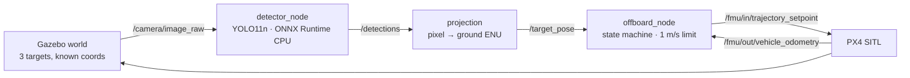
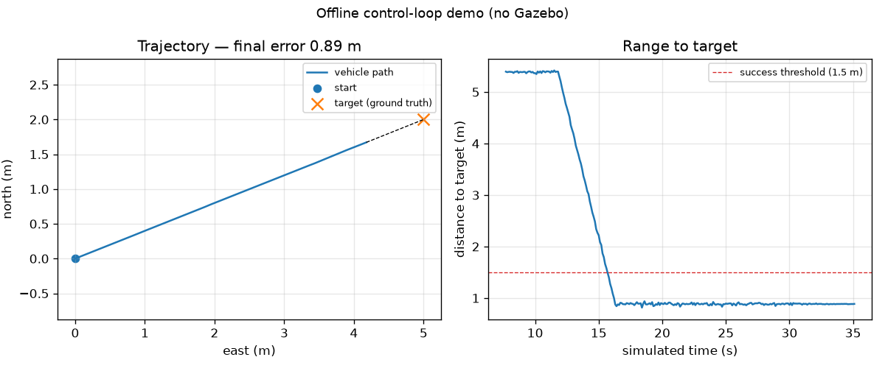

# uav-yolo-offboard-tracking

[](https://github.com/wuuu854-boop/uav-yolo-offboard-tracking/actions/workflows/ci.yml)
[](https://github.com/wuuu854-boop/uav-yolo-offboard-tracking/actions/workflows/ros.yml)
[](https://github.com/wuuu854-boop/uav-yolo-offboard-tracking/releases)
[](LICENSE)
[](https://www.python.org/)

**UAV vision in the loop, measured.** Detection → pixel-to-ground projection → PX4 Offboard approach in Gazebo SITL, with a trial harness that turns every run into a CSV row and an environment doctor that diagnoses this stack's setup failures.

> **Why this exists.** The most-starred project in this niche ([406★](https://github.com/monemati/PX4-ROS2-Gazebo-YOLOv8)) stops at *detect + fly by keyboard*: no closed loop, no metrics. Searching GitHub for `px4 offboard target tracking` returns **0 repositories**. So this is not a second detection demo — it is the closed loop plus the measurement layer. Star counts, issue links and the comparison: [`docs/prior-art.md`](docs/prior-art.md).

<!-- TODO(v0.1.0): 用 assets/01-demo.gif 替换下面这行，规格见 assets/README.md -->
> 🎬 Demo GIF 待补（`assets/01-demo.gif`，1280×720，≤20 s，≤8 MB）。

## Results

> **状态：MVP 进行中。** 下表是待填模板，不是结果。每个单元格必须能追溯到
> `results/*.csv` 的对应行；未实测的一律保持 `—`，不要填估计值。

| Method | Detector | Input | Detection rate | Latency p50 / p95 (ms) | Landing error median (m) | Success |
|---|---|---|---|---|---|---|
| Baseline | colour threshold (HSV) | 640×480 | — | — | — | — |
| Ours | YOLO11n · ONNX Runtime CPU | 640×480 | — | — | — | — |

Hardware: <!-- TODO: CPU 型号 / 内存 / 有无 GPU，例如 Intel i5-1240P, 16 GB, no dGPU -->

两个后端在同一批画面上对比。默认 world 由颜色基线驱动闭环（合成方块对 COCO
预训练 YOLO 是零样本失败），YOLO 一行只填延迟与检测率，不粉饰。

Source: [`results/detection_bench.csv`](results/detection_bench.csv) ·
[`results/latency.csv`](results/latency.csv) ·
[`results/landing_error.csv`](results/landing_error.csv)

## What is verified, and what is not

| Layer | Status | Evidence |
|---|---|---|
| Geometry, frame conversions, mission logic, recorder | ✅ verified | `pytest` (148 tests) + `make demo` |
| YOLO letterbox / decode / NMS | ✅ verified | `tests/test_yolo.py` (13 tests) |
| ROS 2 packages build, both nodes run | ✅ verified in CI | `ROS build` workflow on `ros:humble`: detector against synthetic images, controller against fake PX4 traffic |
| Version matrix, world structure, camera intrinsics | ✅ checked | `make doctor`, `check_world_targets.py` in CI |
| Closed loop in Gazebo SITL | ⬜ **not run yet** | `results/landing_error.csv` is empty |

The last row is the only claim this repository does not yet support, and it is
deliberately left empty rather than filled with an estimate. What each of the
other rows was checked against — including the four defects that check found —
is recorded in [`docs/verification-log.md`](docs/verification-log.md).

## Skills

Every problem this stack produced, written up as a short procedure with a
verification step — not a blog post, not folklore:

| | |
|---|---|
| [01](skills/01-silent-topic.md) | A topic that publishes and a node that receives nothing (QoS) |
| [02](skills/02-camera-mount.md) | Telling a nadir camera from a forward one |
| [03](skills/03-world-plugins.md) | Keeping a PX4 Gazebo world valid |
| [04](skills/04-intrinsics-from-sdf.md) | Deriving intrinsics from the model file |
| [05](skills/05-version-drift.md) | Pinning `px4_msgs` against `px4_ros_com` |
| [06](skills/06-numpy-abi.md) | The numpy 2 / `cv_bridge` segfault |
| [07](skills/07-claim-to-csv.md) | Turning a run into a number you can defend |

Index and rationale: [`skills/README.md`](skills/README.md).

To point all of this at your own target, camera or scene, follow
[`docs/adoption.md`](docs/adoption.md) — it lists what to change and the check
that proves each change worked. To read the code instead, start with
[`docs/review-guide.md`](docs/review-guide.md): one guarantee per module, with the
test that would fail if it broke.

## Stack

| Layer | Component | Version |
|---|---|---|
| Flight stack | PX4 SITL, model `x500_mono_cam_down` | v1.15.x |
| Simulator | Gazebo Harmonic (`gz sim`) | gz-sim 8 |
| Middleware | ROS 2 Humble + uXRCE-DDS (`px4_msgs`) | Humble |
| Perception | YOLO11n → ONNX Runtime (CPU), or HSV baseline | ORT ≥ 1.17 |
| Camera | 1280×960, HFOV 1.74 rad, nadir (fx = 538.4) | from the PX4 model |
| Language | Python 3.10 / C++17 | — |

## Architecture



Details: [`docs/architecture.md`](docs/architecture.md) (frame conventions, topic contract, state machine).

## Quick start

Verified on **Ubuntu 22.04 + ROS 2 Humble**. Windows/macOS are not supported for the simulator.

```bash
git clone https://github.com/wuuu854-boop/uav-yolo-offboard-tracking.git && cd uav-yolo-offboard-tracking
bash scripts/setup.sh          # 检查环境 + 建 venv + 装依赖（不会自动 sudo apt）
cp .env.example .env           # 填 PX4_DIR 等本地路径
source .venv/bin/activate
colcon build --packages-select uav_interfaces && source install/setup.bash
make doctor                    # 六项环境检查，失败时直接给修复命令
make sim                       # 起 Gazebo + PX4 SITL（终端 A）
make detect                    # 只跑检测节点，验证 /detections 有输出（终端 B）
make e2e                       # 闭环：起飞 → 检测 → 抵近 → 悬停 → 降落
```

> **Windows 用户**：PX4 SITL 只能跑在 Linux 上。用 WSL2 + Ubuntu 22.04（Windows 11
> 自带 WSLg，Gazebo 图形界面可用）或双系统。WSL2 下 Gazebo 帧率通常偏低：如果
> `ros2 topic hz /camera/image_raw` 达不到 15 Hz，先查 WSL 的 GPU 加速，而不是改代码。

### No Linux yet? Check the logic in ten seconds

```bash
python3 scripts/offline_demo.py     # or: make demo
```

Runs the real `projection.py` and `state_machine.py` against a synthetic camera
and a point-mass vehicle: takeoff → detect → approach → hover → land. It writes
`results/offline_demo.csv` and a two-panel plot.

It validates **geometry and mission logic only** — no dynamics, no perception
failure, not a result. The numbers that belong in the table come from SITL.



*Produced by `make demo`: takeoff to 10 m, approach, hover, land. The title
reports the final error of that run.*

## Reproduce

```bash
bash scripts/download_data.sh  # 校验本地模型权重与样例数据（权重不随仓库分发）
make e2e
make bench                     # results/landing_error.csv -> README 结果表
```

## Repository layout

```
src/uav_tracking/perception/   YOLO ONNX 检测节点、像素→地面投影（纯函数，有单测）、颜色基线
src/uav_tracking/control/      NED↔ENU 帧转换、任务状态机（纯 Python，有单测）、Offboard 节点、目标选择、实验记录器
src/uav_interfaces/  自定义 Target / TargetArray 消息
sim/              Gazebo world（3 个已知坐标目标）与桥接 launch
config/           相机内参、检测参数、任务参数、目标真值
scripts/          doctor.py（环境诊断）、benchmark.py（结果汇总）、setup / e2e / 导出
results/          实验原始数据（CSV），README 中每个数字的来源
docs/             坐标约定、实验协议、先例分析、故障排查、场景预算、AI 使用记录（索引：[docs/README.md](docs/README.md)）
```

## Results & failure analysis

<!-- TODO(v0.1.0): 填 3 条实测结论 + 至少 2 条失败模式。示例格式：
- 目标出画：偏航对准前目标移出视野 → 丢失 2 s 后悬停，未触发重搜。
- 误检：地面阴影被识别为目标，setpoint 跳变 3.4 m，被 jump filter 丢弃。 -->

- 待填。
- 待填。

## Limitations

- **仅 SITL 仿真，没有真机飞行。** 不写"实飞验证"。
- 推理在 x86 CPU 上完成，**未在 Jetson / RK3588 上实测**。
- 假设目标静止、地面水平、相机严格下视；roll/pitch 未补偿。
- 单目标；多目标跟踪属于 v0.2.0 范围。
- 搜索是固定方形草坪扫描（20 m、间距 8.9 m），不含重规划，也不覆盖大面积区域。
- 默认 world 是合成彩色方块，COCO 预训练 YOLO 对其**零样本检测率为 0**，
  因此闭环演示使用 `backend: baseline`，YOLO 只用于延迟/部署基准；
  用 Gazebo 渲染帧自动标注并微调是 v0.2.0 的任务（见 `sim/README.md`）。

## License

代码采用 [MIT](LICENSE)。模型权重由 Ultralytics YOLO11 训练，遵循 **AGPL-3.0**，
仅供研究与学习使用；第三方组件署名见 [NOTICE](NOTICE)。

## Citation

<!-- TODO: 拿到 Zenodo DOI 后取消注释并填写
If you use this work, please cite:
```
@software{uav_yolo_offboard_tracking,
  title  = {uav-yolo-offboard-tracking},
  author = {<你的名字>},
  year   = {2026},
  doi    = {10.5281/zenodo.xxxxxxx}
}
```
-->

## Acknowledgements

[PX4-Autopilot](https://github.com/PX4/PX4-Autopilot) (BSD-3-Clause) ·
[ROS 2](https://github.com/ros2) (Apache-2.0) ·
[Gazebo](https://github.com/gazebosim/gz-sim) (Apache-2.0) ·
[Ultralytics YOLO](https://github.com/ultralytics/ultralytics) (AGPL-3.0)

## AI-assisted development

Parts of this repository were drafted with LLM assistance (DeepSeek / Claude).

- **AI-drafted:** ROS 2 node boilerplate, launch files, plotting scripts, README wording.
- **Human-reviewed and verified:** coordinate transforms (unit tests in
  `tests/test_projection.py`), mission safety logic (speed limit, target-loss hover,
  jump filter), and every reported number (traceable to `results/*.csv`).
- Known AI failure cases are documented in [`docs/ai-usage.md`](docs/ai-usage.md).

No result in this repository is AI-generated or estimated.
