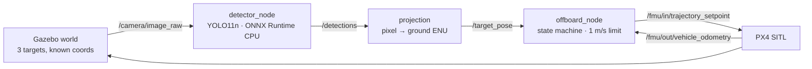

# uav-yolo-offboard-tracking

[](https://github.com/wuuu854-boop/uav-yolo-offboard-tracking/actions/workflows/ci.yml)
[](https://github.com/wuuu854-boop/uav-yolo-offboard-tracking/actions/workflows/ros.yml)
[](https://github.com/wuuu854-boop/uav-yolo-offboard-tracking/releases)
[](LICENSE)
[](https://www.python.org/)
[](https://github.com/wuuu854-boop/uav-yolo-offboard-tracking/actions/workflows/ci.yml)

**UAV vision in the loop, measured.** Detection → pixel-to-ground projection → PX4 Offboard approach in Gazebo SITL, with a trial harness that turns every run into a CSV row and an environment doctor that diagnoses this stack's setup failures.

> **Why this exists.** The most-starred project in this niche ([406★](https://github.com/monemati/PX4-ROS2-Gazebo-YOLOv8)) stops at *detect + fly by keyboard*: no closed loop, no metrics. Searching GitHub for `px4 offboard target tracking` returns **0 repositories**. So this is not a second detection demo — it is the closed loop plus the measurement layer. Star counts, issue links and the comparison: [`docs/prior-art.md`](docs/prior-art.md).


*One of the nine trials, seen by the vehicle's own camera: the target cube and
its shadow, then the vehicle's shadow entering frame as it settles overhead.
Recorded with `scripts/record_frames.py` during `make e2e`.*

## Results

Nine closed-loop SITL trials (3 targets × 3 runs) on Ubuntu 22.04 (WSL2),
Gazebo Harmonic 8.15, PX4 v1.15.0, with the colour-threshold detector driving
the loop.

| Metric | Value |
|---|---|
| Success (landing error ≤ 1.5 m) | **9/9 (100%)** |
| Landing error, median | **0.73 m** |
| Landing error, p95 | 1.14 m |
| End-to-end latency, p50 | **143 ms** |
| End-to-end latency, p95 | 272 ms |
| Latency samples | 18,222 |

| Target | Trials | Error median (m) |
|---|---|---|
| 0 | 3 | 0.85 |
| 1 | 3 | 0.58 |
| 2 | 3 | 0.73 |

Source: [`results/landing_error.csv`](results/landing_error.csv) ·
[`results/latency_raw.csv`](results/latency_raw.csv) ·
[`results/state_trace.csv`](results/state_trace.csv). Regenerate the table with
`make bench`; the latency percentiles are pooled from every raw sample, not
averaged from per-trial medians.

What the first runs measured, and why the numbers moved — this is the part that
makes the table trustworthy:

- **2.4–3.5 m in trials 1–4** were not flight errors. The recorder compared
  PX4's *local* position (zero at spawn) with *world* ground truth, so the 3.5 m
  spawn offset was counted as error. `localise_targets()` fixed the frame.
- **~0.8 m of the remainder** was the vehicle finishing a rate-limited setpoint
  during the hover: arrival and landing positions differed by exactly that much
  in every trace. Hovering now holds the current position.
- What is left (0.50–1.28 m) is detection latency and the 1.0 m reach tolerance,
  not a systematic offset — the p95 is 1.14 m.

The YOLO row is deliberately absent: no ONNX model has matched the baseline
**yet**. A model was trained for this scene ([`docs/model.md`](docs/model.md):
0.98 mAP@50 on held-out synthetic data, 100/100 detections in the batch tool),
and a channel-order decoding bug that made it unusable was found and fixed. The
first three trials with it wandered off; after hard negatives harvested from real
Gazebo frames the next three land, but at 2.21/2.36/2.28 m — a systematic offset,
not noise, and `results/v03_yolo_trials.csv` holds those rows. The measured loop
therefore stays on the colour baseline until that offset is explained.

**Version provenance.** The table is the nine-trial set measured with **v0.1.0**.
v0.2.0 changes safety behaviour only — a geofence, a mission timeout and a
requirement that a target be seen for consecutive frames before the mission acts
on it. Three further runs with that code measured 0.94 m, 1.01 m and 1.49 m, all
within tolerance ([`results/v02_validation.csv`](results/v02_validation.csv)).
One run during that validation missed by 5.6 m because a single frame during the
search was believed; that is what `confirm_frames` exists for, and why the three
rows above are a verification rather than a replacement of the nine.

Hardware: Intel i7-14650HX (24 threads), 32 GB RAM, no discrete GPU in the VM —
Gazebo rendered headless through WSL2.

## What is verified, and what is not

| Layer | Status | Evidence |
|---|---|---|
| Geometry, frame conversions, mission logic, recorder | ✅ verified | `pytest` (201 tests) + `make demo` |
| YOLO letterbox / decode / NMS | ✅ verified | `tests/test_yolo.py` (13 tests) |
| Cross-frame identity (`track_id`) | ✅ verified | `tests/test_tracking.py` (12 tests) + a ROS test that the id survives two frames |
| ROS 2 packages build, both nodes run | ✅ verified in CI | `ROS build` workflow on `ros:humble`: detector against synthetic images, controller against fake PX4 traffic |
| Version matrix, world structure, camera intrinsics | ✅ checked | `make doctor`, `check_world_targets.py` in CI |
| Closed loop in Gazebo SITL | ✅ **verified** | 9/9 trials, median 0.73 m, p50 143 ms; [`results/landing_error.csv`](results/landing_error.csv) |
| PX4 change needed for those trials | ✅ documented and patchable | [`patches/px4-v1.15-gz-magnetometer.patch`](patches/px4-v1.15-gz-magnetometer.patch) + `make patch-px4`; unpatched PX4 will not arm |

The last row is the only claim this repository does not yet support, and it is
deliberately left empty rather than filled with an estimate. What each of the
other rows was checked against — including the four defects that check found —
is recorded in [`docs/verification-log.md`](docs/verification-log.md).

## Skills

Every problem this stack produced, written up as a short procedure with a
verification step — not a blog post, not folklore:

| | |
|---|---|
| [01](skills/01-silent-topic.md) | A topic that publishes and a node that receives nothing (QoS) |
| [02](skills/02-camera-mount.md) | Telling a nadir camera from a forward one |
| [03](skills/03-world-plugins.md) | Making a PX4 world load its systems |
| [04](skills/04-intrinsics-from-sdf.md) | Deriving intrinsics from the model file |
| [05](skills/05-version-drift.md) | Pinning `px4_msgs` against `px4_ros_com` |
| [06](skills/06-numpy-abi.md) | The numpy 2 / `cv_bridge` segfault |
| [07](skills/07-claim-to-csv.md) | Turning a run into a number you can defend |

Index and rationale: [`skills/README.md`](skills/README.md).

To point all of this at your own target, camera or scene, follow
[`docs/adoption.md`](docs/adoption.md) — it lists what to change and the check
that proves each change worked. To read the code instead, start with
[`docs/review-guide.md`](docs/review-guide.md): one guarantee per module, with the
test that would fail if it broke.

## Stack

| Layer | Component | Version |
|---|---|---|
| Flight stack | PX4 SITL, model `x500_mono_cam_down` | v1.15.x |
| Simulator | Gazebo Harmonic (`gz sim`) | gz-sim 8 |
| Middleware | ROS 2 Humble + uXRCE-DDS (`px4_msgs`) | Humble |
| Perception | YOLO11n → ONNX Runtime (CPU), or HSV baseline | ORT ≥ 1.17 |
| Camera | 1280×960, HFOV 1.74 rad, nadir (fx = 538.4) | from the PX4 model |
| Language | Python 3.10 / C++17 | — |

## Architecture



Details: [`docs/architecture.md`](docs/architecture.md) (frame conventions, topic contract, state machine).

## Quick start

Verified on **Ubuntu 22.04 + ROS 2 Humble**. Windows/macOS are not supported for the simulator.

```bash
git clone https://github.com/wuuu854-boop/uav-yolo-offboard-tracking.git && cd uav-yolo-offboard-tracking
bash scripts/setup.sh          # 检查环境 + 建 venv + 装依赖（不会自动 sudo apt）
cp .env.example .env           # 填 PX4_DIR 等本地路径
source .venv/bin/activate
colcon build --packages-select uav_interfaces && source install/setup.bash
make doctor                    # 六项环境检查，失败时直接给修复命令
make patch-px4                 # PX4 v1.15 缺磁力计回调；打补丁并重编译
make sim                       # 起 Gazebo + PX4 SITL（终端 A）
make preflight                 # 不开仿真，先查配置/依赖/目录是否齐备
make detect                    # 只跑检测节点，验证 /detections 有输出（终端 B）
make e2e                       # 闭环：起飞 → 检测 → 抵近 → 悬停 → 降落
```

> **Windows 用户**：PX4 SITL 只能跑在 Linux 上。用 WSL2 + Ubuntu 22.04（Windows 11
> 自带 WSLg，Gazebo 图形界面可用）或双系统。WSL2 下 Gazebo 帧率通常偏低：如果
> `ros2 topic hz /camera/image_raw` 达不到 15 Hz，先查 WSL 的 GPU 加速，而不是改代码。

### No Linux yet? Check the logic in ten seconds

```bash
python3 scripts/offline_demo.py     # or: make demo
```

Runs the real `projection.py` and `state_machine.py` against a synthetic camera
and a point-mass vehicle: takeoff → detect → approach → hover → land. It writes
`results/offline_demo.csv` and a two-panel plot.

It validates **geometry and mission logic only** — no dynamics, no perception
failure, not a result. The numbers that belong in the table come from SITL.


*Produced by `make demo`: takeoff to 10 m, approach, hover, land. The title
reports the final error of that run.*

## Reproduce

```bash
bash scripts/download_data.sh  # 校验本地模型权重与样例数据（权重不随仓库分发）
make e2e
make bench                     # results/landing_error.csv -> README 结果表
```

## Repository layout

```
src/uav_tracking/perception/   YOLO ONNX 检测节点、像素→地面投影（纯函数，有单测）、颜色基线
src/uav_tracking/control/      NED↔ENU 帧转换、任务状态机（纯 Python，有单测）、Offboard 节点、目标选择、实验记录器
src/uav_interfaces/  自定义 Target / TargetArray 消息
sim/              Gazebo world（3 个已知坐标目标）与桥接 launch
config/           相机内参、检测参数、任务参数、目标真值
scripts/          doctor.py（环境诊断）、benchmark.py（结果汇总）、setup / e2e / 导出
results/          实验原始数据（CSV），README 中每个数字的来源
docs/             坐标约定、实验协议、先例分析、故障排查、场景预算、AI 使用记录（索引：[docs/README.md](docs/README.md)）
```

## Results & failure analysis

Three things the nine trials settled:

- **The loop closes on its own.** Nine of nine landed within 1.5 m, median
  0.73 m, with no operator input beyond starting the run. The trace for every
  trial shows the same shape: arm → climb → approach → hover 3 s → land.
- **The two failures were in the measurement, not the flight.** The first four
  runs scored 2.4–3.5 m because the recorder compared PX4's local frame with
  world ground truth; the next four lost ~0.8 m to a stale hover setpoint. Both
  are visible in `results/state_trace.csv` before they are visible in the error.
- **Latency does not drive the error.** At p50 143 ms the vehicle moves 0.14 m
  between frame and setpoint at 1 m/s, which is inside the reach tolerance of
  1.0 m. The spread in landing error tracks detection jitter, not delay.

Failure modes this system actually produced, each with the check that catches it:

- **Target lost mid-approach** → hover 2 s, then a lawnmower search; the trace
  shows `GOTO → HOVER(target_lost) → SEARCH → GOTO(target reacquired)`. That
  path ran in the target-1 trials before the colour ranges were fixed, and it is
  why the vehicle did not simply hover forever.
- **Wrong frame, right flight** → every error was exactly the spawn offset.
  `localise_targets()` plus two unit tests make the frame conversion explicit
  instead of implicit.
- **Stale setpoint on arrival** → arrival and landing positions differed by
  0.5–0.9 m in all traces; hover now commands the current position.

## Limitations

- **仅 SITL 仿真，没有真机飞行。** 不写"实飞验证"。
- 推理在 x86 CPU 上完成，**未在 Jetson / RK3588 上实测**。
- 假设目标静止、地面水平、相机严格下视；roll/pitch 未补偿。
- 单目标；多目标跟踪属于 v0.2.0 范围。
- 搜索是固定方形草坪扫描（20 m、间距 8.9 m），不含重规划，也不覆盖大面积区域。
- 默认 world 是合成彩色方块，COCO 预训练 YOLO 对其**零样本检测率为 0**，
  因此闭环演示使用 `backend: baseline`，YOLO 只用于延迟/部署基准；
  用 Gazebo 渲染帧自动标注并微调是 v0.2.0 的任务（见 `sim/README.md`）。

## License

代码采用 [MIT](LICENSE)。模型权重由 Ultralytics YOLO11 训练，遵循 **AGPL-3.0**，
仅供研究与学习使用；第三方组件署名见 [NOTICE](NOTICE)。

## Citation

<!-- TODO: 拿到 Zenodo DOI 后取消注释并填写
If you use this work, please cite:
```
@software{uav_yolo_offboard_tracking,
  title  = {uav-yolo-offboard-tracking},
  author = {<你的名字>},
  year   = {2026},
  doi    = {10.5281/zenodo.xxxxxxx}
}
```
-->

## Acknowledgements

[PX4-Autopilot](https://github.com/PX4/PX4-Autopilot) (BSD-3-Clause) ·
[ROS 2](https://github.com/ros2) (Apache-2.0) ·
[Gazebo](https://github.com/gazebosim/gz-sim) (Apache-2.0) ·
[Ultralytics YOLO](https://github.com/ultralytics/ultralytics) (AGPL-3.0)

## AI-assisted development

Parts of this repository were drafted with LLM assistance (DeepSeek / Claude).

- **AI-drafted:** ROS 2 node boilerplate, launch files, plotting scripts, README wording.
- **Human-reviewed and verified:** coordinate transforms (unit tests in
  `tests/test_projection.py`), mission safety logic (speed limit, target-loss hover,
  jump filter), and every reported number (traceable to `results/*.csv`).
- Known AI failure cases are documented in [`docs/ai-usage.md`](docs/ai-usage.md).

No result in this repository is AI-generated or estimated.
