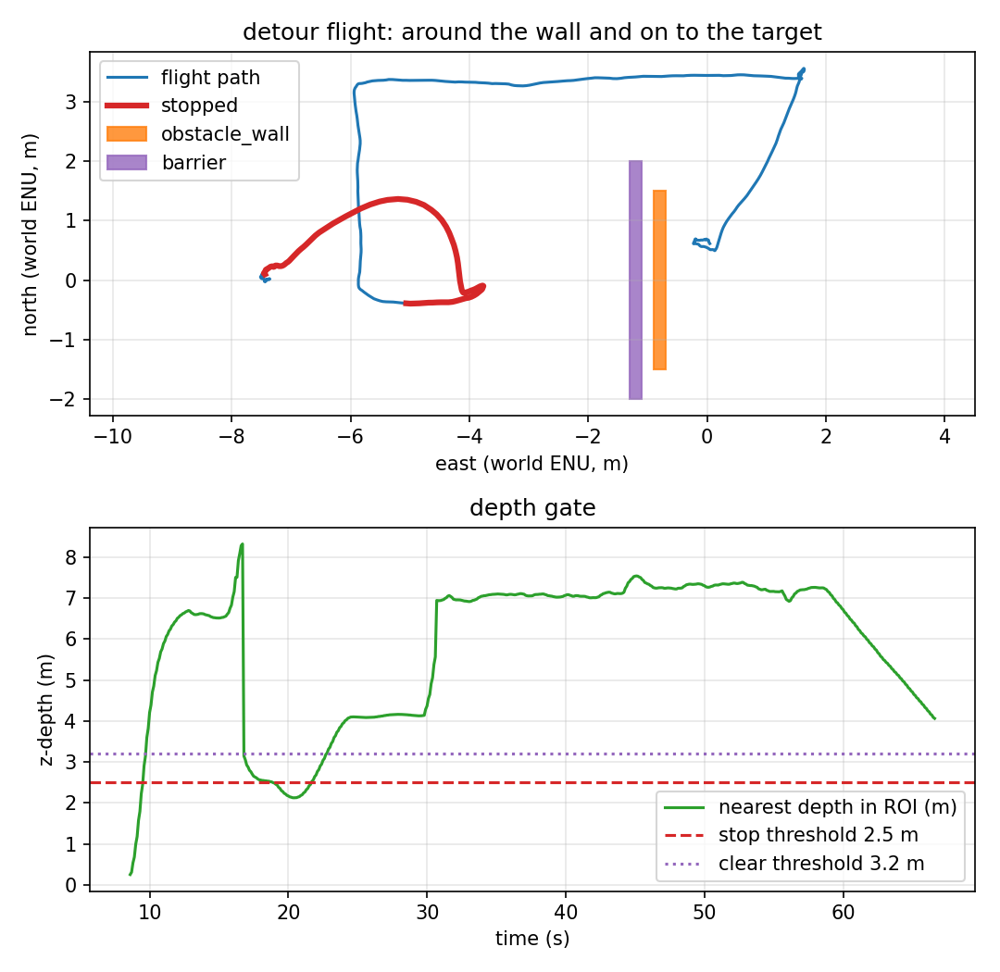

# Sizing the back-off from the measurement

Phases 5–6 used a configured distance (2 m, or repeated 0.2 m steps). Phase 7
sizes the step from the two strip distances the depth node already computes.



*The red segment shows the stop and the single 2.0 m retreat; the blue L starts
from the cleared position.*

## The rule

The depth node publishes `/avoidance/side_clearance`
(`std_msgs/Float32MultiArray`, `[left_m, right_m]`, `NaN` for no return). The
controller computes:

```text
needed = backoff_target_m - max(left_m, right_m)
step   = clamp(needed, min_step_m, max_step_m)
```

The idea is that a step straight back raises the side distance roughly
one-for-one. If the better side is 3.2 m and the target is 6.0 m, the step is
2.8 m, capped at 2.0 m. A missing value (`NaN`) returns no step and the configured
`backoff_m` is used; with `backoff_m: 0` that means hold. The trace records the
chosen step (`backing off 2.00 m`).

The planner's `set_backoff_step()` is still bounded by `backoff_max_attempts`.
With target 6.0 and one 2.0 m step the retained run cleared immediately; a second
step is covered by `tests/test_detour.py` but was not needed in this flight.

## The scenario

`make adaptive` uses the phase-4 barrier world, the 6.0 m side floor
([`config/depth_adaptive.yaml`](../config/depth_adaptive.yaml)) and
[`config/mission_adaptive.yaml`](../config/mission_adaptive.yaml):

- `detour_backoff_m: 0.0` — no fixed step; without a measured step it would hold;
- `detour_adaptive_backoff: true`, target 6.0 m, clamp 0.2–2.0 m;
- `detour_forward_m: 7.5` — with 6 m the return to target_0 cut the wall corner
  (below the 0.4 m check), so the leg is longer.

## What the run measured

One headless SITL flight, `make adaptive`, 2026-11-11. Raw data:
[`results/adaptive_run.csv`](../results/adaptive_run.csv) (667 rows at 10 Hz),
[`results/adaptive_summary.json`](../results/adaptive_summary.json),
[`results/adaptive_trace.csv`](../results/adaptive_trace.csv),
[`results/adaptive_landing.csv`](../results/adaptive_landing.csv).

| Metric | Value | How it is measured |
|---|---|---|
| Stop engaged | **yes**, at t = 18.9 s | first `stop=1` row |
| Side clearances at the stop | **left 3.20 m, right 2.32 m** | `left_m`, `right_m` columns |
| Computed step | **2.00 m** (`6.0 − 3.20 = 2.8`, capped at 2.0) | trace |
| Back-off travel | **2.02 m** (3.72 → 1.70 m east) | trace positions |
| Side after the step | **left** | trace + `clear_side` |
| Lateral leg | **3.566 m** max north | path |
| Forward leg | **7.5 m** | mission config |
| Gate released | **yes** | report |
| Final target error | **0.618 m** | final CSV row |
| Landing row | **0.572 m**, `success=True`, `patrol complete` | recorder |
| Minimum wall clearance | **0.47 m** | vehicle centre to the wall AABB |
| Contacts (wall + barrier) | **0** | both `gz.msgs.Contacts` topics |
| Depth frames | 1001 (≈15 Hz) | recorder |
| Flight duration | 66.6 s | CSV |

Report: `scripts/avoidance_report.py --mode detour` → eight checks, all PASS.

## Reproducing it

```bash
make install-world
make adaptive
```

The target uses `config/mission_adaptive.yaml`, world
`target_tracking_blocked`, prefix `adaptive`, `config/depth_adaptive.yaml` and
the phase-4 barrier. It fails if the stop does not happen, the target is not
reached, the clearance is below 0.4 m, or either contact sensor fires.

## What is verified, and what is not

| Claim | Status | Evidence |
|---|---|---|
| The side distances reach the controller | ✅ verified | `left_m`/`right_m` columns; 3.20/2.32 at the stop |
| The step is computed, not configured | ✅ verified | `backoff_m: 0.0` yet the trace says `2.00 m` |
| The computed step clears the side | ✅ verified | one step, left, then lateral |
| The run reaches target_0 without contact | ✅ verified | 0.618 m final error, 0.572 m landing, 0 contacts |
| A second adaptive step in SITL | ❌ **not observed** | unit-tested only; the first step cleared |
| Adapting the direction, not only the distance | ❌ **not implemented** | step is straight back along the approach |
| Multiple obstacles / dynamic obstacles / global planning | ❌ **not verified** | one static barrier + wall |
| A real depth sensor | ❌ **not verified** | ideal Gazebo float32 depth |

## Known artifacts

- The calculation assumes the side distance grows one-for-one with the retreat.
  The measured 2.02 m step is consistent; a different geometry would need the
  loop rather than one open-loop step.
- `backoff_target_m` (6.0) is the same as the depth node's `min_clear_side_m`.
  They are separate config keys because the controller must not import the depth
  node's config; they have to be kept in step by hand.
- The side floor must stay below the floor return in the lower strip (~7.3 m at
  5 m altitude), or the floor counts as a permanent obstacle.
- The first stop event in `depth_node.log` (nearest 0.25 m) is the ground during
  takeoff; the controller is in `TAKEOFF` and ignores it.
