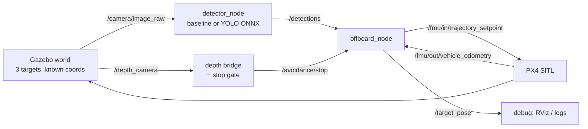
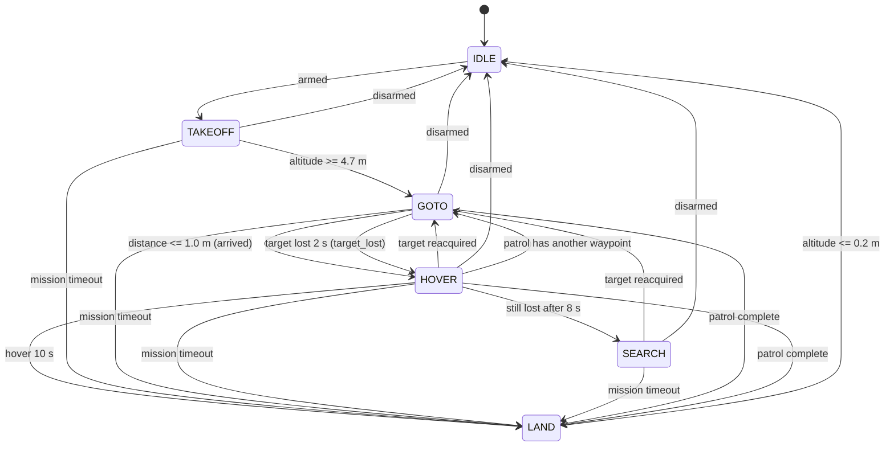

# Architecture

## Data flow



The depth path is a second, intentionally small loop: the camera is forward and
tilted down, the gate decides only "stop or not", and the control node treats a
stop as "hold the horizontal setpoint". It does not plan around anything. Details:
[`avoidance.md`](avoidance.md).

The projection lives **inside** `offboard_node`, not in a separate node: it needs
the vehicle pose, which the control side already has. Keeping it there means the
detector can be replayed from a rosbag with no PX4 running.

## Frame conventions (the most common source of bugs)

| Frame | Convention | Where it appears |
|---|---|---|
| World | ENU: `+x` east, `+y` north, `+z` up | `config/targets.yaml`, `/target_pose` |
| Body | FRD: `+x` forward, `+y` right, `+z` down | camera mounting, `projection.py` |
| Gazebo model | FLU: `+x` forward, `+y` left, `+z` up | `mount_offset_xyz` in `config/camera.yaml` |
| PX4 odometry | NED: `x` north, `y` east, `z` down | `/fmu/out/vehicle_odometry` |
| Yaw | REP-103: 0 = east, `+pi/2` = north | `projection.py`, odometry |

## Camera mounting

`x500_mono_cam_down` mounts PX4's `mono_cam` sensor with a +90° pitch about y and
a 0.10 m height offset, giving a strictly nadir view with the image top pointing
to body +x. `estimate_target_enu()` applies that offset; disabling it introduces
a 0.10 m vertical error that scales the ground offset by about 2 % at 5 m.

The similarly named `x500_mono_cam` is **forward-looking** and cannot be used
with this projection — see `docs/troubleshooting.md` #10.

The forward depth camera added in v0.9.0 is mounted at body `(0.20, 0, -0.02)`
and pitched 30° down. It is not the nadir camera and it is not used for
projection: it publishes z-depth in metres on `/depth_camera`, which
`scripts/gz_depth_bridge.py` republishes as a ROS `32FC1` image. The controller
commands `heading_yaw_deg` (NED, clockwise from north) so the camera faces the
direction of travel; the avoidance mission sets 90° (east).

NED is converted to ENU **only at the PX4 boundary** (`src/uav_tracking/control/frames.py`):

```
east  =  position[1]      north =  position[0]      up = -position[2]
yaw_enu = pi/2 - yaw_ned        # the heading convention differs too
```

That second line is the one people forget: PX4 yaw is clockwise from north,
ROS yaw is counter-clockwise from east. Skipping it produces a constant 90°
error that looks exactly like a wrongly mounted camera.

If the UAV consistently flies to a mirrored position, one of these is wrong:
the yaw convention, the camera `image_up_is_forward` flag, or the NED/ENU swap.
Check them in that order — they are listed from most to least likely.

## Topic contract

| Topic | Type | Direction | QoS |
|---|---|---|---|
| `/camera/image_raw` | `sensor_msgs/Image` | bridge → detector | sensor data (best effort) |
| `/camera/depth/image_raw` | `sensor_msgs/Image` (`32FC1`) | depth bridge → depth node | sensor data (best effort) |
| `/avoidance/stop` | `std_msgs/Bool` | depth node → control | default (reliable, depth 10) |
| `/avoidance/nearest_m` | `std_msgs/Float32` | depth node → recorder | default |
| `/avoidance/clear_side` | `std_msgs/String` (`left`/`right`/`blocked`/`unknown`) | depth node → control | default |
| `/avoidance/side_clearance` | `std_msgs/Float32MultiArray` `[left_m, right_m]` | depth node → control/recorder | default |
| `/detections` | `uav_interfaces/TargetArray` | detector → control | default (reliable, depth 10) |
| `/target_pose` | `geometry_msgs/PoseStamped` | control → debug | default |
| `/fmu/out/vehicle_odometry` | `px4_msgs/VehicleOdometry` | PX4 → control | default |
| `/fmu/out/vehicle_status` | `px4_msgs/VehicleStatus` | PX4 → control | default |
| `/fmu/in/offboard_control_mode` | `px4_msgs/OffboardControlMode` | control → PX4 | default |
| `/fmu/in/trajectory_setpoint` | `px4_msgs/TrajectorySetpoint` | control → PX4 | default |
| `/fmu/in/vehicle_command` | `px4_msgs/VehicleCommand` | control → PX4 | default |

`/detections` is published even when nothing is found, so the consumer can tell
"no detections" apart from "detector died" by looking at the timestamp.

## Mission states



The four `mission timeout` edges land a mission that never converges
(`max_mission_s`, disabled by default) so a broken detector cannot hover until
the battery decides. Separately from the state machine, every horizontal setpoint
is clamped to `geofence_radius_m` around the spawn point before it is published:
a bad estimate becomes a boundary command, not a flight away.

The two patrol edges only exist when `patrol_waypoints` is non-empty. A patrol
leg is waypoint-driven: the detection of the target just visited must not pull
the vehicle back, which is the bug the first patrol flight found. When the queue
is exhausted the node calls `request_land`, so the mission ends from wherever it
is instead of re-targeting an estimate.

The three `disarmed` edges exist because PX4 can disarm in flight (failsafe,
battery, a manual kill). Without them the node would keep commanding a climb or
an approach to a vehicle that is no longer flying.

`SEARCH` sweeps a lawnmower pattern around the point where the target was last
seen: hovering forever only works if the target comes back on its own. Lanes are
spaced at `coverage_spacing(11.9 m, 0.25)` — the footprint from
`docs/scenario.md` minus a quarter overlap — so consecutive passes are contiguous.

The stop gate is deliberately **not** a new mission state. It is a modifier on
`GOTO`: while `/avoidance/stop` is true, the horizontal setpoint is latched at
the vehicle position and the state machine keeps reporting `GOTO`. Takeoff,
hover and landing ignore the gate. A watchdog turns a depth stream that stops
arriving into a stop; before the first message it is inactive, so missions that
do not run the depth node are unchanged. See [`avoidance.md`](avoidance.md).

The phase-2 detour is the same pattern: `GOTO` plus an L-shaped modifier with
`LATERAL → FORWARD → WAITING` phases. The gate starts the detour but is ignored
during the two legs, because flying sideways is the escape; it is consulted at
the forward point before turning back. The planner never becomes a mission state,
and a mission with `detour_enabled: false` behaves exactly as before. See
[`detour.md`](detour.md).

Phase 3 adds the side: the depth node compares the nearest return in a left and a
right strip outside the centre ROI, applies a 0.5 m margin and publishes
`/avoidance/clear_side`. The controller passes that value to the planner at the
first stopped tick when `detour_auto_side` is set; the fixed `detour_side` is the
fallback for `unknown`. See [`side-selection.md`](side-selection.md).

Phase 4 adds the refusal: a third value, `blocked`, when both strips are inside
`min_clear_side_m`. The controller latches `blocked` for the rest of the stop and
holds; `detour_start_delay_s` keeps it from committing during the settle
transient. It does not search or back off; the mission times out and lands. See
[`blocked.md`](blocked.md).

Phase 5 adds one recovery move: with `backoff_m` set, `blocked` starts a
`BACKOFF` leg opposite the approach, then re-reads the side at the back-off
point. A free side starts the normal L from there; otherwise the planner holds
and does not repeat. See [`backoff.md`](backoff.md).

Phase 6 makes the back-off a bounded loop: `backoff_max_attempts` repeats the
same `backoff_m` step, re-reading at every position; `stopped: backing off
again (n/max)` is in the trace. When the budget is spent the planner holds and
does not resume on a gate that is merely clear because of the retreat. See
[`backoff-sweep.md`](backoff-sweep.md).

Phase 7 adds the measurement: `/avoidance/side_clearance` carries the two strip
distances, and the controller sizes the next step as
`clamp(target − max(left, right), 0.2, 2.0)` through
`DetourPlanner.set_backoff_step()`. The configured `backoff_m` is only the
fallback. See [`adaptive.md`](adaptive.md).

Phase 8 adds a `SEARCH` phase: a blocked stop shifts `search_step_m` sideways
toward the freer side, re-reads, and starts the lateral leg from there; bounded
by `search_max_attempts`, then holds. See [`search.md`](search.md).

Phase 9 adds a known-map planner outside the reactive stack:
`uav_tracking.planning.global_planner.plan_path()` runs grid A* around inflated
axis-aligned boxes and smooths the result; the offboard plans once per goal,
follows the waypoints, and takes the final target. The mission supplies the map
and may disable the reactive stop explicitly. See [`global.md`](global.md).

Phase 10 adds a one-shot perception handoff: with `global_perception`, the first
cruise stop (`nearest_m` plus pose and yaw) becomes one conservative box, the
planner replans around it, and the reactive stop is ignored for the rest of the
mission. It is one range and one replan, not an occupancy map. See
[`perception-planning.md`](perception-planning.md).

Phase 11 adds a fifth `Box` field, `angle_rad`; `contains()` rotates the query
point into the box frame, so grid A*, inflation and line-of-sight work for a
rotated wall. The report measures the exact rotated shape. See
[`rotated.md`](rotated.md).

Phase 12 exercises two rotated boxes at once (30° wall and 45° pillar) with two
contact sensors. See [`rotated-multi.md`](rotated-multi.md).

Phase 13 adds a real doorway task: two gate segments with a 2.4 m gap, goal at
target_0 itself, landing through the gap. See [`gate.md`](gate.md).

Phase 14 moves the gate away from the target: an offset 2.4 m gap at x = 9.2 and
target_1 at (20, 0), so the route threads the gap and then turns to target_1. The
report takes `--target-id` so it measures target_1. See
[`gate-target1.md`](gate-target1.md).

Phase 15 chains two offset gates (north gap at x = 1.2, south gap at x = 12.2)
before target_1. See [`gate-double.md`](gate-double.md).

Phase 16 repeats the doorway missions and aggregates the evidence. gate is
**5/5**, gate-double **5/5**, and gate-target1 margin **16/20** at n=20 (3
timeouts, 1 catastrophic 186-contact run). The target1 scenario is **not
robust**; the 10/10 at n=10 was a small-sample illusion. See
[`repeatability.md`](repeatability.md).

Two different ways into `HOVER` with two different exits — this is the part that
a naive implementation gets wrong: if you land after a target-loss hover, a
single missed frame ends the mission.

## Design decisions

| Decision | Why | What would change it |
|---|---|---|
| Two nodes, not three | projection needs the pose; fewer hops to debug | a multi-vehicle setup where projection is shared |
| uXRCE-DDS + `px4_msgs`, not MAVROS 2 | one less layer, official PX4 ROS 2 path | needing MAVLink-specific features or ArduPilot support |
| 5 Hz detection, 50 Hz control | inference jitter must not reach the setpoint; decoupling is architectural, not tuning | a detector that runs >30 Hz on the target hardware |
| Jump filter in the control node | one bad box would move the setpoint metres; safety belongs with the actuator | a learned tracker with its own motion model |
| Colour baseline kept in the repo | honest comparison and a fallback when the model is missing | never — this is the point of the baseline |

## Known failure modes

| Symptom | Likely cause | Where to look |
|---|---|---|
| UAV flies mirrored | `image_up_is_forward` wrong | `config/camera.yaml`, one known target |
| Error grows with altitude | wrong intrinsics (`fx`) | `docs/scenario.md` budget calculation |
| Setpoint jumps every few frames | no jump filter / wrong filter limit | `config/mission.yaml` |
| Control oscillates | detection running inside the control loop | `publish_rate_hz` vs `control_rate_hz` |
| Landing error ~0 but wrong target | ground truth YAML not matching the world | `config/targets.yaml` vs the SDF |
| No `/depth_camera` topic | depth-camera model not installed, or PX4 started with another model | `make install-world`, `gz topic -l \| grep depth` |
| Depth gate stops on the ground at takeoff | near clip / low altitude; the controller ignores stop outside `GOTO` | `log/depth_node.log`, `stop_events` |
| Vehicle flies past the wall | wrong `heading_yaw_deg`, so the forward camera was not pointed at it | `config/mission_avoidance.yaml`, yaw in `avoidance_run.csv` |
| Detour touches the wall's corner | forward leg too short for a target close to the wall | `results/detour_trace.csv`, `docs/detour.md` |
| Detour never releases the gate | the forward extension budget is spent or the gate is stale | `detour_summary.json`, `detour_trace.csv` |
