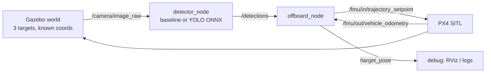
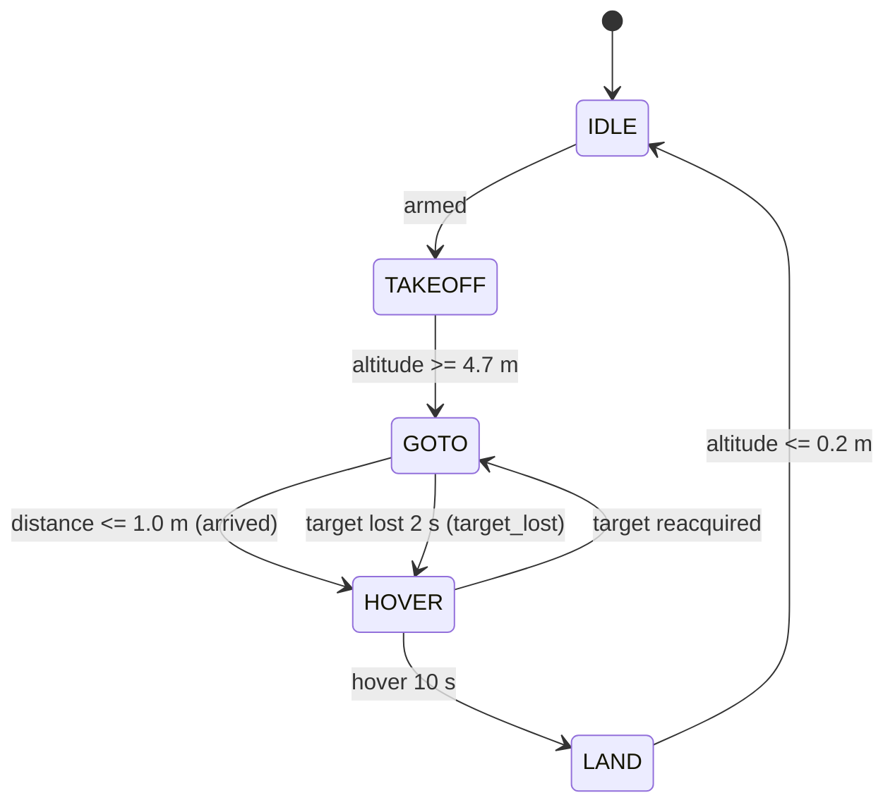

# Architecture

## Data flow



The projection lives **inside** `offboard_node`, not in a separate node: it needs
the vehicle pose, which the control side already has. Keeping it there means the
detector can be replayed from a rosbag with no PX4 running.

## Frame conventions (the most common source of bugs)

| Frame | Convention | Where it appears |
|---|---|---|
| World | ENU: `+x` east, `+y` north, `+z` up | `config/targets.yaml`, `/target_pose` |
| Body | FRD: `+x` forward, `+y` right, `+z` down | camera mounting, `projection.py` |
| PX4 odometry | NED: `x` north, `y` east, `z` down | `/fmu/out/vehicle_odometry` |
| Yaw | REP-103: 0 = east, `+pi/2` = north | `projection.py`, odometry |

NED is converted to ENU **only at the PX4 boundary**:

```
east  =  position[1]      north =  position[0]      up = -position[2]
```

If the UAV consistently flies to a mirrored position, one of these is wrong:
the yaw convention, the camera `image_up_is_forward` flag, or the NED/ENU swap.
Check them in that order — they are listed from most to least likely.

## Topic contract

| Topic | Type | Direction | QoS |
|---|---|---|---|
| `/camera/image_raw` | `sensor_msgs/Image` | bridge → detector | sensor data (best effort) |
| `/detections` | `uav_interfaces/TargetArray` | detector → control | default (reliable, depth 10) |
| `/target_pose` | `geometry_msgs/PoseStamped` | control → debug | default |
| `/fmu/out/vehicle_odometry` | `px4_msgs/VehicleOdometry` | PX4 → control | default |
| `/fmu/out/vehicle_status` | `px4_msgs/VehicleStatus` | PX4 → control | default |
| `/fmu/in/offboard_control_mode` | `px4_msgs/OffboardControlMode` | control → PX4 | default |
| `/fmu/in/trajectory_setpoint` | `px4_msgs/TrajectorySetpoint` | control → PX4 | default |
| `/fmu/in/vehicle_command` | `px4_msgs/VehicleCommand` | control → PX4 | default |

`/detections` is published even when nothing is found, so the consumer can tell
"no detections" apart from "detector died" by looking at the timestamp.

## Mission states



Two different ways into `HOVER` with two different exits — this is the part that
a naive implementation gets wrong: if you land after a target-loss hover, a
single missed frame ends the mission.

## Design decisions

| Decision | Why | What would change it |
|---|---|---|
| Two nodes, not three | projection needs the pose; fewer hops to debug | a multi-vehicle setup where projection is shared |
| uXRCE-DDS + `px4_msgs`, not MAVROS 2 | one less layer, official PX4 ROS 2 path | needing MAVLink-specific features or ArduPilot support |
| 5 Hz detection, 50 Hz control | inference jitter must not reach the setpoint; decoupling is architectural, not tuning | a detector that runs >30 Hz on the target hardware |
| Jump filter in the control node | one bad box would move the setpoint metres; safety belongs with the actuator | a learned tracker with its own motion model |
| Colour baseline kept in the repo | honest comparison and a fallback when the model is missing | never — this is the point of the baseline |

## Known failure modes

| Symptom | Likely cause | Where to look |
|---|---|---|
| UAV flies mirrored | `image_up_is_forward` wrong | `config/camera.yaml`, one known target |
| Error grows with altitude | wrong intrinsics (`fx`) | `docs/scenario.md` budget calculation |
| Setpoint jumps every few frames | no jump filter / wrong filter limit | `config/mission.yaml` |
| Control oscillates | detection running inside the control loop | `publish_rate_hz` vs `control_rate_hz` |
| Landing error ~0 but wrong target | ground truth YAML not matching the world | `config/targets.yaml` vs the SDF |
