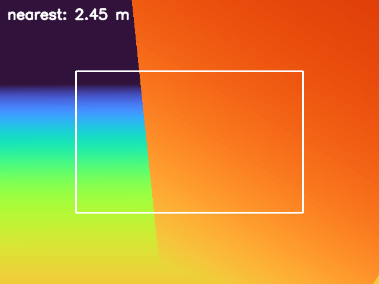
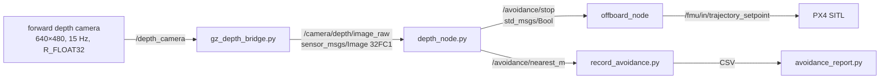
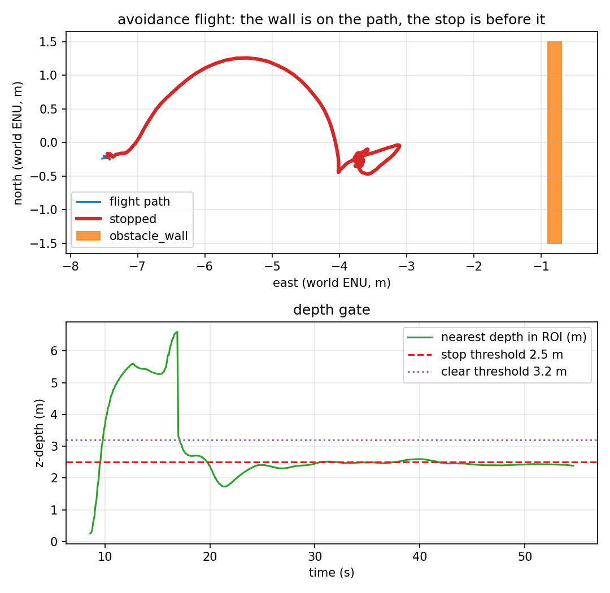

# Depth camera and the stop gate

Phase 1 of the obstacle-avoidance work: **one forward depth camera, one reactive
stop, one SITL flight**. It is deliberately not path planning, not mapping and
not a claim about a real depth sensor. Phase 2 (a fixed-side L-shaped detour) is
in [`detour.md`](detour.md); this document only states what phase 1 built and
measured.



*The frame that stopped the vehicle, recorded by `scripts/record_avoidance.py`.
The white box is the ROI that may command a stop; orange is the wall at 2.4 m,
the dark band is sky/far, the gradient at the bottom is the ground. Colours are
inverted (near = red) from `cv2.COLORMAP_TURBO`.*

## Data path



The bridge is hand-written for the same reason as the image bridge: the Humble
`ros_gz_bridge` is built against Fortress-era gz-msgs and receives nothing from
Harmonic. `gz_depth_bridge.py` re-wraps the float32 payload without converting
it, so the ROS side receives metres, not millimetres or a colourised image.

## The sensor and the wall

The depth camera lives in `sim/models/x500_mono_cam_down/model.sdf` next to the
nadir camera:

| Property | Value | Why |
|---|---|---|
| Mount | 0.20 m forward, 0.02 m down | in front of the 0.177 m half-body, so the airframe cannot appear in its own centre window |
| Tilt | 30° down (0.5236 rad) | a strictly forward camera misses anything closer than ~3.9 m at 5 m altitude; the tilt covers 3°–57° below the horizon |
| Image | 640×480, `R_FLOAT32`, HFOV 1.2 rad | 1.2 MB/frame at 15 Hz; four times lighter than the 1280×960 nadir camera |
| Clip | 0.2–20 m | the wall approach is 6.7 m; the near clip is why the ground is "no return" at takeoff |
| Topic | `/depth_camera` | Gazebo's depth camera publishes on the sensor topic directly; the point cloud is `/depth_camera/points` |

The obstacle is `obstacle_wall` in
[`sim/worlds/target_tracking_obstacle.sdf`](../sim/worlds/target_tracking_obstacle.sdf):
0.2 × 3.0 × 6.0 m at world `(-0.8, 0, 3.0)`, 0.8 m west of `target_0`. Six metres
is taller than the 5 m takeoff setpoint on purpose: a 4 m wall would be flown
over without any avoidance and "did not collide" would be true for the wrong
reason. Three metres wide keeps the wall in the centre window with half a metre
of lateral drift.

The wall's pose and size are duplicated in [`config/obstacle.yaml`](../config/obstacle.yaml)
because `scripts/avoidance_report.py` computes the clearance from that file.
`scripts/check_world_targets.py` compares the two and fails when only one moves.

## The stop decision

All of this is pure Python in [`src/uav_tracking/perception/depth.py`](../src/uav_tracking/perception/depth.py)
and has unit tests; the node is only wiring.

1. **Valid returns.** A pixel counts if it is finite, above `min_valid_m` (0.25 m)
   and at most `max_valid_m` (12 m). Zero is "no return", not "touching the lens".
2. **ROI.** The centre 60% × 50% of the image. Values are **z-depth along the
   optical axis**, not Euclidean range; with a 30° tilt the same wall reads about
   0.87 × its horizontal distance. `config/depth.yaml` says so next to the numbers.
3. **Hysteresis.** Stop at ≤ 2.5 m, release only at ≥ 3.2 m. The gate latches, so
   one noisy frame at the boundary cannot toggle the command.
4. **Watchdog.** The depth node publishes at 10 Hz. If depth frames stop arriving
   it publishes stop (fail safe) after 0.5 s. The controller has a second, longer
   watchdog (1.0 s): once `/avoidance/stop` has been seen, silence means stop. If
   the topic was never seen, the watchdog is inactive — a mission that does not
   run the depth node is unchanged.
5. **Control.** The stop overrides **GOTO only**. Takeoff, hover and landing keep
   their commands: refusing to climb or to land because a wall is in front would
   turn an obstacle into a different incident. The hold point is the vehicle
   position at the first stopped tick, and it is latched — following the vehicle's
   own drift would move the setpoint toward the wall.

## What the run measured

One headless SITL flight, `make avoid`, 2026-11-10. Spawn `(-7.5, 0, 0.05)` facing
east, waypoint `target_0` at world (0, 0), approach speed 0.6 m/s, 40 s mission
timeout. Raw data: [`results/avoidance_run.csv`](../results/avoidance_run.csv)
(547 rows at 10 Hz), [`results/avoidance_summary.json`](../results/avoidance_summary.json),
[`results/avoidance_trace.csv`](../results/avoidance_trace.csv).

| Metric | Value | How it is measured |
|---|---|---|
| Stop engaged | **yes**, at t = 19.8 s | first row with `stop=1` after the wall stop |
| Approach held before timeout | **25.1 s** | trace: `GOTO,avoidance stop` 9827.17 → `LAND` 9852.27 |
| Settled drift after the stop | **0.124 m** | max displacement 10 s after the stop to the end |
| Movement after the trigger | +0.585 m forward, −0.092 m back | `stop_advance_m`, `stop_retreat_m` |
| Minimum wall clearance | **2.204 m** (at t = 21.2 s) | vehicle centre to the wall AABB, world ENU |
| Contacts on the wall | **0** | `gz.msgs.Contacts`, positive-tested below |
| Depth frames bridged | **822** (≈15 Hz) | counter in the recorder |
| Nearest depth at the stop | 2.48 m at trigger, 2.45 m in the saved frame | depth node / recorder |
| Landing row | 3.70 m from target_0, `success=False`, `mission timeout` | [`results/avoidance_landing.csv`](../results/avoidance_landing.csv) |

The landing row is **not** a tracking-trial result: the vehicle stopped 2.6 m
short of the waypoint, the mission timed out and landed from there. That is the
expected outcome of this scenario, not a failed approach.



*Top: the wall (orange) is between the spawn and the target; the red segment is
the stopped interval. The approach drifts up to ~1.3 m north during the climb —
visible, and the reason the wall is 3 m wide rather than 1.2 m. Bottom: the ROI's
nearest z-depth crosses the 2.5 m threshold and stays below the 3.2 m release
threshold for the rest of the flight.*

## Reproducing it

```bash
make install-world   # copies both worlds and the depth-camera model
make avoid           # headless SITL: takeoff -> stop before the wall -> land
```

`make avoid` writes the CSV, the trace, the depth frame, the plot and the JSON
summary, then runs `scripts/avoidance_report.py`; the target fails if any check
fails. The wall's contact sensor is in the world, and the recorder subscribes to
the topic Gazebo actually creates:
`/world/target_tracking_obstacle/model/obstacle_wall/link/link/sensor/contact/contact`.

## The contact sensor is checked positively

`contacts_total=0` is only evidence if the sensor can produce a contact. A 0.5 kg
box dropped from 1.5 m above the wall produced **4632 contact messages** on the
same topic. The raw output is in
[`results/contact_sensor_check.txt`](../results/contact_sensor_check.txt). The
check is manual because it starts a simulator; the avoidance run itself is
repeated by `make avoid`.

## What is verified, and what is not

| Claim | Status | Evidence |
|---|---|---|
| The depth camera publishes real metres, not zeros | ✅ verified | 822 frames, min/percentiles in the recorder log; frame above |
| Nearest-return + hysteresis + watchdog logic | ✅ verified | `tests/test_depth.py`, `tests/ros/test_depth_node.py` |
| Stop holds the approach in SITL | ✅ verified | stop at 19.8 s, 25.1 s hold, settled drift 0.124 m |
| The vehicle did not touch the wall | ✅ verified | min clearance 2.204 m, 0 contacts, sensor positive-tested |
| The gate works with a real depth sensor | ❌ **not verified** | no hardware; Gazebo returns ideal float32 depth with no noise, holes or multipath |
| Dynamic or moving obstacles | ❌ **not verified** | the wall is static; no tracking of an obstacle |
| Path planning around an obstacle | ❌ **not in this phase** | the vehicle stops and waits; it does not go around |
| Higher speed / shorter stop distance | ❌ **not verified** | 0.6 m/s was chosen for this geometry; 1.0 m/s overshot the trigger by ~0.6 m |
| Going around the obstacle | ✅ **phase 2** | fixed-side L-shaped detour, [`detour.md`](detour.md); it is not a planner |
| A negative control (fly into the wall) | ❌ **not run** | the wall is on the approach line and the contact sensor works, but no deliberate collision was flown |

## Known artifacts in the logs

- During the first seconds of the climb the camera looks at the ground inside
  the near clip and publishes stop with `nearest 0.25 m` (the first stop event in
  `depth_node.log`). The controller is in `TAKEOFF` and ignores it; it clears
  1.1 s later. The recorder keeps `stop_events` and `min_nearest_m` so this is
  visible rather than hidden. The wall stop is the second event.
- The approach drifts north during the climb (up to ~1.3 m in the plot). The PX4
  position controller and the takeoff transient cause it; the 3 m wall means the
  depth ROI still contains the wall. A narrower obstacle would need a tighter
  approach or a wider ROI.
- PX4's local z at rest reads about 1 m in this SITL setup while the Gazebo model
  sits on the ground; the takeoff setpoint is therefore not the physical camera
  height. The clearance metric uses horizontal odometry only, and the wall is
  taller than the setpoint either way.
