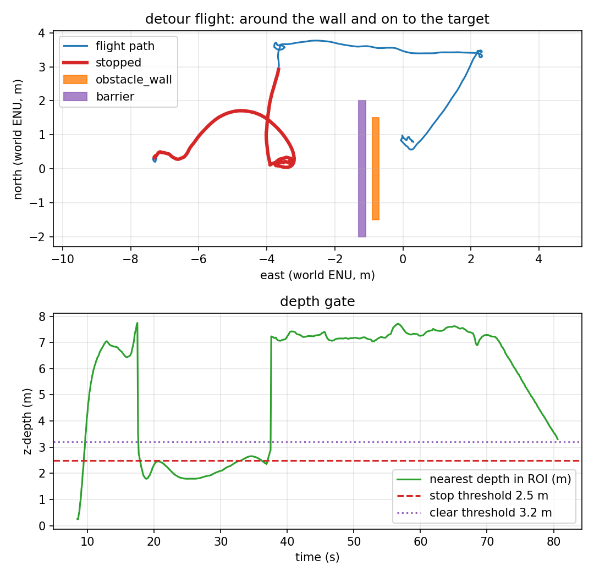

# Repeating the back-off

Phase 5 backed off once (2 m) and held if that was not enough. Phase 6 repeats
the same step until a budget is spent: `backoff_max_attempts`. Each step is a
fresh decision made **at the new position**, not a longer precomputed leg.



*The red cluster west of the barrier is the stop plus four 0.2 m back-off steps.
The blue L starts when the fourth step finally clears both strips.*

## The loop

1. The gate stops at the barrier and the side label settles to `blocked`.
2. The planner sets a waypoint `backoff_m` (0.2 m) opposite the approach.
3. On reaching it, it re-reads the side:
   - `left`/`right` → start the lateral leg from here;
   - still `blocked` and budget remains → another `backoff_m` step, with the
     trace note `still blocked: backing off again (n/max)`;
   - still `blocked` and budget spent → `HOLDING`.
4. `HOLDING` after a back-off does **not** resume just because the gate reads
   clear: backing away makes the gate clear while the obstacle is still in front.
   It recovers only if a side clears, otherwise the mission times out.

The steps are 0.2 m because the point is to exercise the loop; with a 1 m step
the first clear point was passed before the next decision. The reach tolerance
for this mission is 0.05 m so each step is actually flown.

## The scenario

`make backoff-sweep` uses the phase-4 barrier world
(`target_tracking_blocked.sdf`: a 0.2 × 4.0 × 6.0 m barrier at `(-1.2, 0)`) and
the 6.0 m side floor ([`config/depth_backoff_sweep.yaml`](../config/depth_backoff_sweep.yaml)).
The barrier's strips stay below 6.0 m for the first three steps and clear on the
fourth. The mission is
[`config/mission_backoff_sweep.yaml`](../config/mission_backoff_sweep.yaml):
`backoff_m: 0.2`, `backoff_max_attempts: 4`, `detour_forward_m: 6.0`.

## What the run measured

One headless SITL flight, `make backoff-sweep`, 2026-11-11. Raw data:
[`results/sweep_run.csv`](../results/sweep_run.csv) (807 rows at 10 Hz),
[`results/sweep_summary.json`](../results/sweep_summary.json),
[`results/sweep_trace.csv`](../results/sweep_trace.csv),
[`results/sweep_landing.csv`](../results/sweep_landing.csv).

| Metric | Value | How it is measured |
|---|---|---|
| Stop engaged | **yes**, at t = 17.9 s | first `stop=1` row |
| Back-off attempts | **4** (`2/4`, `3/4`, `4/4` in the trace) | trace |
| Back-off travel | **0.62 m** (4.29 m → 3.67 m on east; 0.2 m waypoints) | trace positions |
| Side at the last step | **left** | trace + `clear_side` |
| Lateral leg | **3.772 m** max north | path |
| Forward leg | **6.0 m** | mission config |
| Gate released | **yes** | report |
| Final target error | **0.852 m** | final CSV row |
| Landing row | **0.808 m**, `success=True`, `patrol complete` | recorder |
| Minimum wall clearance | **0.639 m** | vehicle centre to the wall AABB |
| Contacts (wall + barrier) | **0** | both `gz.msgs.Contacts` topics |
| Depth frames | 1212 (≈15 Hz) | recorder |
| Flight duration | 80.6 s | CSV |

Report: `scripts/avoidance_report.py --mode detour` → eight checks, all PASS.

## Reproducing it

```bash
make install-world
make backoff-sweep
```

The target uses `config/mission_backoff_sweep.yaml`, world
`target_tracking_blocked`, prefix `sweep`, `config/depth_backoff_sweep.yaml` and
the phase-4 barrier. It fails if the stop does not happen, the target is not
reached, the clearance is below 0.4 m, or either contact sensor fires.

## What is verified, and what is not

| Claim | Status | Evidence |
|---|---|---|
| The back-off repeats until a side clears | ✅ verified | four steps, `(2/4)`…`(4/4)`, then lateral |
| The fourth position is a fresh decision | ✅ verified | each step's side is re-read; trace starts the L there |
| The loop reaches target_0 after clearing | ✅ verified | 0.852 m final error, 0.808 m landing, 8/8 checks |
| It does not touch the wall or barrier | ✅ verified | 0 contacts, 0.639 m clearance |
| An adaptive step size / direction | ❌ **not implemented** | fixed 0.2 m, straight back |
| Sweeping sideways when straight back fails | ❌ **not implemented** | only the approach axis |
| Multiple obstacles / dynamic obstacles / global planning | ❌ **not verified** | one static barrier + wall |
| A real depth sensor | ❌ **not verified** | ideal Gazebo float32 depth |

## Known artifacts

- The first stopped rows say `left`; the `blocked` label arrives a fraction of a
  second later and is latched. The trace's first back-off note is the evidence
  that the latch won.
- The summary's `stop_retreat_m` (0.346 m) is measured from the first stopped
  row; the 0.62 m above is the trace distance from where the first back-off
  started. The vehicle crept forward during the 1 s start delay, so the two
  numbers are not the same measurement.
- The side floor must stay below the ground return in the lower strip (~7.3 m at
  5 m altitude). An 8 m floor counts the floor as a permanent obstacle and the
  sweep never clears.
- The first stop event in `depth_node.log` (nearest 0.25 m) is the ground during
  takeoff; the controller is in `TAKEOFF` and ignores it.
