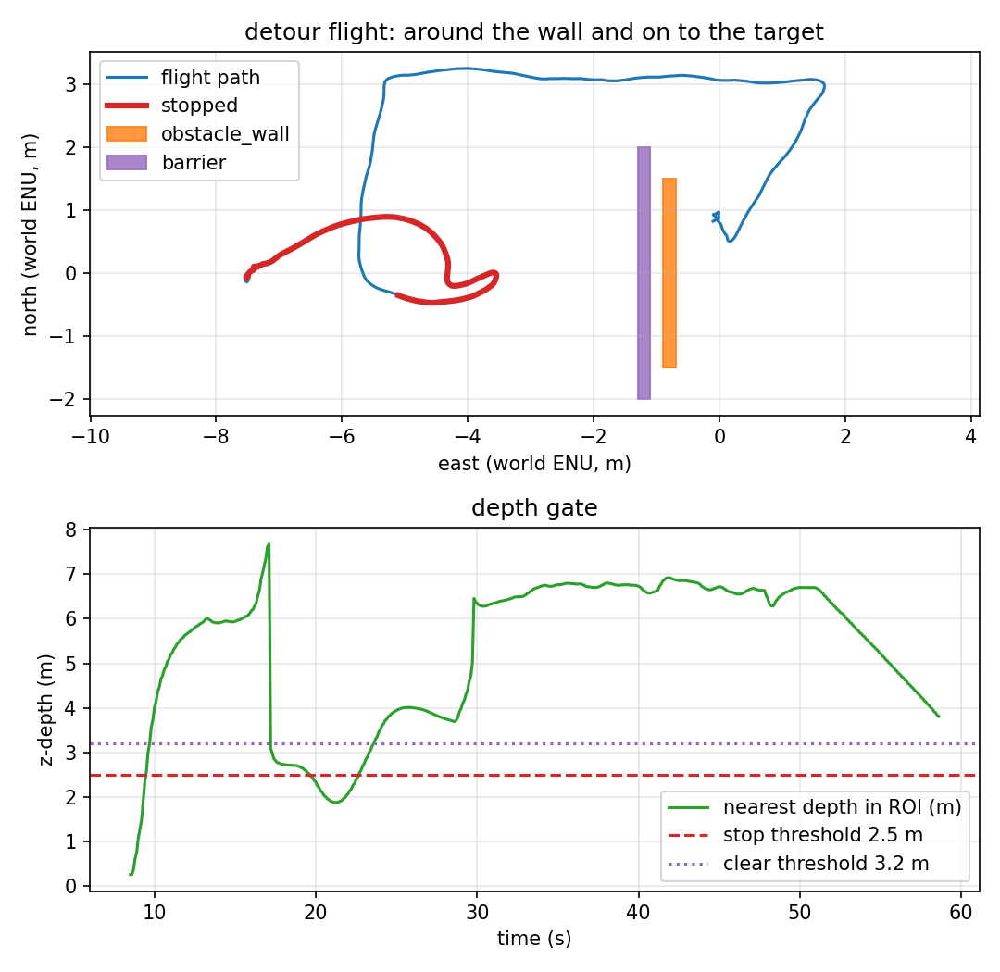

# Backing off to recover

Phase 4 held when both side strips were blocked. Phase 5 adds one recovery move:
back straight away from the obstacle, re-read the strips, and if a side is now
free, fly the L from there. If no side clears, it holds. It is still not a
search: one back-off distance, one retry, no map. Phase 6 adds a bounded repeat
of the same step; see [`backoff-sweep.md`](backoff-sweep.md).



*The red segment contains the stop, the 2 m back-off waypoint and the lateral
leg; the blue path goes around the barrier's north end to target_0.*

## The sequence

1. The gate stops at the barrier. The side label is `left` on the first stopped
   frame, `blocked` about half a second later; the controller latches `blocked`.
2. After `detour_start_delay_s` (1.0 s) the planner enters **`BACKOFF`**: the
   waypoint is `backoff_m` (2.0 m) opposite the approach direction.
3. On reaching it, the planner re-reads the side label. From 2 m further back the
   barrier's 4 m width no longer fills both 20% strips: the left strip is free.
4. It starts the lateral leg from the back-off point (3.5 m), flies 7 m forward
   past the barrier, waits for the gate to clear and resumes target_0.
5. If both strips are still blocked at the back-off point, the planner enters
   `HOLDING` and does not repeat the back-off in this phase-5 mission (the
   phase-6 sweep repeats it up to a budget). It recovers only if a side clears
   later.

The back-off distance is measured along the **approach axis**, not toward the
camera's current heading: the depth camera is tilted 30° down and the boom is not
the flight direction.

## The scenario

`make backoff` uses the phase-4 blocked world (`target_tracking_blocked.sdf`: a
0.2 × 4.0 × 6.0 m barrier at `(-1.2, 0)`), but a 4.0 m side floor
([`config/depth_backoff.yaml`](../config/depth_backoff.yaml)) so the barrier is
blocked on both sides at the stop. The mission is
[`config/mission_backoff.yaml`](../config/mission_backoff.yaml).

The forward leg is **7 m**, not the phase-2/3 5 m. The first attempt used 5 m
from the back-off point; it ended at the barrier's x and the return to target_0
clipped its north edge, producing contacts. Seven metres puts the forward point
east of the barrier before turning back; the retained run then had 0.595 m
clearance and zero contacts.

## What the run measured

One headless SITL flight, `make backoff`, 2026-11-11. Raw data:
[`results/backoff_run.csv`](../results/backoff_run.csv) (587 rows at 10 Hz),
[`results/backoff_summary.json`](../results/backoff_summary.json),
[`results/backoff_trace.csv`](../results/backoff_trace.csv),
[`results/backoff_landing.csv`](../results/backoff_landing.csv).

| Metric | Value | How it is measured |
|---|---|---|
| Stop engaged | **yes**, at t = 19.7 s | first `stop=1` row |
| Back-off | **`detour: both sides blocked: backing off` → `backoff done: lateral leg`** | trace |
| Measured back-off | **1.63 m** (from 3.91 m to 2.28 m along east; waypoint was 2.0 m, tolerance 0.5 m) | trace positions |
| Side after back-off | **left** | trace + `clear_side` |
| Lateral leg | **3.254 m** max north | path |
| Forward leg | **7.0 m** | mission config |
| Gate released | **yes** | report |
| Final target error | **0.831 m** | final CSV row |
| Landing row | **0.684 m**, `success=True`, `patrol complete` | recorder |
| Minimum wall clearance | **0.595 m** | vehicle centre to the wall AABB |
| Contacts (wall + barrier) | **0** | both `gz.msgs.Contacts` topics |
| Depth frames | 882 (≈15 Hz) | recorder |
| Flight duration | 58.6 s | CSV |

Report: `scripts/avoidance_report.py --mode detour` → eight checks, all PASS.

## Reproducing it

```bash
make install-world
make backoff
```

The target uses `config/mission_backoff.yaml`, world
`target_tracking_blocked`, prefix `backoff`, `config/depth_backoff.yaml` and the
phase-4 barrier. It fails if the stop does not happen, the target is not reached,
the clearance is below 0.4 m, or either contact sensor fires.

## What is verified, and what is not

| Claim | Status | Evidence |
|---|---|---|
| Both-blocked triggers a back-off | ✅ verified | trace `backing off` → `backoff done` |
| A free side reappears after backing off | ✅ verified | `clear_side=left` at the back-off point |
| The L from the back-off point reaches target_0 | ✅ verified | 0.831 m final error, 0.684 m landing, 8/8 checks |
| It does not touch the wall or barrier | ✅ verified | 0 contacts, 0.595 m clearance |
| Repeating the back-off until a side appears | ✅ **phase 6** | bounded sweep, 0.2 m steps; see [`backoff-sweep.md`](backoff-sweep.md) |
| Choosing a different back-off distance | ❌ **not implemented** | fixed `backoff_m` in the mission |
| Multiple obstacles / dynamic obstacles / global planning | ❌ **not verified** | one static barrier + wall |
| A real depth sensor | ❌ **not verified** | ideal Gazebo float32 depth |

## Known artifacts

- The side label on the first stopped row is `left`; the latch and the 1 s delay
  are what let the blocked state win. The back-off starts at t = 20.7 s, one
  second after the stop.
- The back-off waypoint is 2.0 m behind the position at the stop, but the
  reached point is 1.63 m behind it: the reach tolerance is 0.5 m and the
  controller brakes. The trace positions are the evidence; the config is the
  command, not the measurement.
- The first stop event in `depth_node.log` (nearest 0.25 m) is the ground during
  takeoff; the controller is in `TAKEOFF` and ignores it.
- The first phase-5 attempt with a 5 m forward leg clipped the barrier and was
  rejected; the 7 m leg is the fix, not a different back-off. Only the retained
  run's numbers are in this table.
