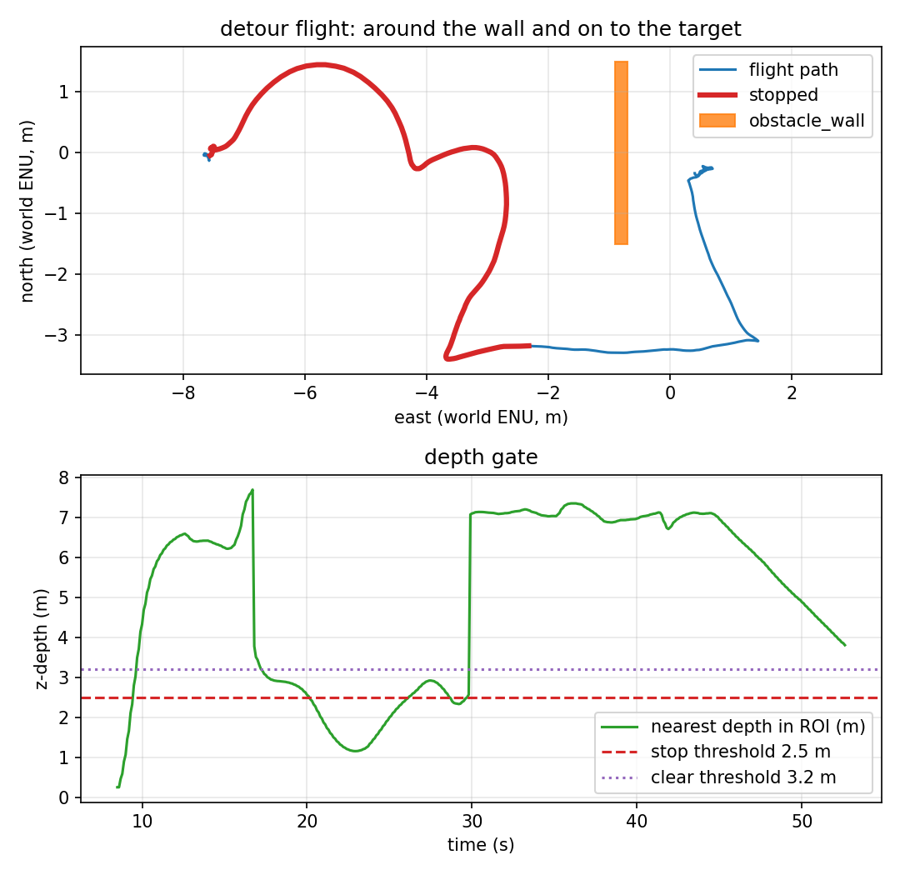

# Going around: the L-shaped detour

Phase 2 of the avoidance work. Phase 1 stopped in front of the wall
([`avoidance.md`](avoidance.md)); this phase flies around it and continues to the
target. It is still deliberately small: **one fixed side, one L, one static
obstacle, no map**.



*Top: the vehicle stops at the wall (red, because the stop flag is still set),
flies south, then east past the wall's face, then north to target_0 (blue).
Bottom: the depth gate stays below the stop threshold through the lateral leg,
then clears for good at ~30 s.*

## Why an L and not a diagonal

The wall is 3 m wide and the target is 0.8 m behind its centre. The stop point is
about 2.6 m west of the wall. A single lateral leg followed by a diagonal back to
the target must pass the wall's south-east corner; from a 3.5 m lateral leg the
diagonal comes within ~0.2 m of the corner, which is inside the airframe. The
first attempt with a 3 m forward leg did exactly that: the wall's contact sensor
fired and the vehicle lost altitude.

The L fixes the geometry: fly 3.5 m sideways (south of the wall's 1.5 m half
width), then 5 m along the original approach axis (about 2 m east of the wall's
east face), and only then turn back to the target. The final approach stays east
of the wall; the minimum centre-to-wall distance in the accepted run is 0.999 m.

## Phases

Pure logic in [`src/uav_tracking/control/detour.py`](../src/uav_tracking/control/detour.py),
`tests/test_detour.py`; the controller only supplies position, target, the gate
decision and the clock.

| Phase | Commanded waypoint | Exit |
|---|---|---|
| `LATERAL` | start + 3.5 m to the fixed side | within 0.5 m → `FORWARD` |
| `FORWARD` | lateral point + 5 m along the approach axis | within 0.5 m → `WAITING` |
| `WAITING` | hold the forward point | gate clear for 1 s → done; still blocked after 5 s → extend once; exhausted → `HOLDING` |
| `HOLDING` | hold current position | gate clear for 1 s → done |

The gate is **ignored during the two legs on purpose**: the vehicle is already
escaping sideways, and refusing to move while the wall is still in the camera
would make the detour impossible. It is consulted at the forward point, where the
decision to turn back is made. The L is recomputed only if the mission leaves
`GOTO`; the controller resets the planner in every other state.

`config/mission_detour.yaml` is the mission:

```yaml
detour_enabled: true
detour_side: right
detour_offset_m: 3.5
detour_forward_m: 5.0
detour_min_lateral_m: 3.0       # report acceptance, not a command
detour_clear_hold_s: 1.0
detour_wait_timeout_s: 5.0
detour_max_attempts: 2
```

## What the run measured

One headless SITL flight, `make detour`, 2026-11-11. Spawn `(-7.5, 0, 0.05)`
facing east; approach 0.6 m/s. Raw data:
[`results/detour_run.csv`](../results/detour_run.csv) (527 rows at 10 Hz),
[`results/detour_summary.json`](../results/detour_summary.json),
[`results/detour_trace.csv`](../results/detour_trace.csv),
[`results/detour_landing.csv`](../results/detour_landing.csv).

| Metric | Value | How it is measured |
|---|---|---|
| Stop engaged | **yes**, at t = 20.2 s | first `stop=1` row |
| Lateral leg | **3.394 m** max abs north | start and waypoints in the trace |
| Forward leg | 5 m along the approach axis | trace: lateral done 8986.16, forward done 8995.0 |
| Gate released | **yes**, at t = 29.8 s | first `stop=0` after the stop |
| Target reached | **0.527 m** final error | final CSV position vs target_0 |
| Landing row | **0.63 m**, `success=True`, `patrol complete` | recorder |
| Minimum wall clearance | **0.999 m** (at t = 42.2 s) | vehicle centre to the wall AABB |
| Contacts | **0** | `gz.msgs.Contacts`, positive-tested in phase 1 |
| Depth frames | 791 (≈15 Hz) | recorder |
| Flight duration | 52.6 s | CSV |

The report (`scripts/avoidance_report.py --mode detour`) passes eight checks:
stop, detour started, lateral leg ≥ 3.0 m, gate released, target reached, minimum
clearance ≥ 0.4 m, zero contacts, and depth frames present.

The 0.4 m clearance floor is lower than phase 1's 1.0 m **on purpose**: a
successful detour ends at target_0, which is only 0.7 m from the wall face. The
phase-1 threshold applies to the stop-and-wait scenario; here the contact sensor
is the primary check and 0.4 m is the airframe-clearance floor.

## Reproducing it

```bash
make install-world
make detour
```

`make detour` writes the `detour_*` CSVs, trace, depth frame, plot and summary,
then runs the report in detour mode; the target fails if any check fails. The
phase-1 files (`avoidance_*`) are untouched: the script takes `MISSION`,
`PREFIX` and `MODE`, so one orchestration can produce either behaviour.

## What is verified, and what is not

| Claim | Status | Evidence |
|---|---|---|
| The L-shaped detour reaches the target | ✅ verified | 0.527 m final error, `success=True` |
| It does not touch the wall | ✅ verified | 0.999 m minimum clearance, 0 contacts |
| The gate releases after the lateral leg | ✅ verified | `stop=0` from 29.8 s, gate-released check |
| Detour logic (phases, extension, hold) | ✅ verified | `tests/test_detour.py` (20 tests) |
| Side selection based on free space | ❌ **not implemented** | `detour_side: right` is a config constant; a blocked right side would fail |
| More than one obstacle / a map | ❌ **not implemented** | one wall; no occupancy grid, no global planner |
| Dynamic obstacles | ❌ **not verified** | the wall is static |
| A real depth sensor | ❌ **not verified** | ideal Gazebo float32 depth, as in phase 1 |
| Speeds above 0.6 m/s | ❌ **not verified** | this geometry and these leg lengths were tuned at 0.6 m/s |
| A second/third run for variance | ❌ **one run** | the numbers above are one flight; the report refuses a run that misses any check |

## Known artifacts

- The first stop event in `depth_node.log` (nearest 0.25 m) is the ground inside
  the near clip during takeoff; the controller is in `TAKEOFF` and ignores it.
  The wall stop is the second event.
- The stop flag stays true during the lateral and forward legs because the wall is
  still in the camera; the controller ignores it there by design, which is why
  `stop_hold_s` is 9.6 s and is not a "held in place" claim.
- The approach still drifts a little during the climb; the L uses the approach
  direction captured at the stop, not the current bearing to the target, so the
  forward leg cannot cut back toward the wall.
