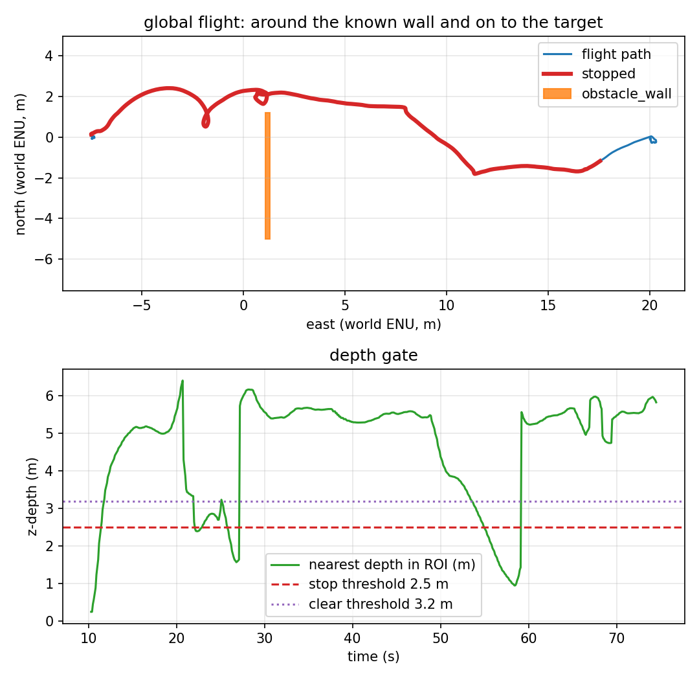

# Two doorways, then target_1

Phase 15 chains two offset gates:

- gate 1 at world x = 1.2, 2.4 m gap at y ∈ [1.2, 3.6] (north),
- gate 2 at world x = 12.2, 2.4 m gap at y ∈ [-3.2, -0.8] (south),
- target_1 at (20, 0).

The route must go **north through gate 1, south through gate 2, then turn to
target_1**. The planner finds **5 waypoints around 4 gate segments**.



## What the run measured

One headless SITL flight, 2026-11-11. Raw data:
[`results/gate_double_run.csv`](../results/gate_double_run.csv) (746 rows at
10 Hz), [`results/gate_double_summary.json`](../results/gate_double_summary.json),
[`results/gate_double_trace.csv`](../results/gate_double_trace.csv),
[`results/gate_double_landing.csv`](../results/gate_double_landing.csv).

| Metric | Value | How it is measured |
|---|---|---|
| Planned waypoints | **5** around 4 gate segments | offboard log |
| Final target error | **0.082 m** to target_1 | final CSV row |
| Landing row | **0.404 m**, target 1, `success=True` | recorder |
| Minimum clearance | **0.45 m** at t = 26.0 s | to the lower gate-1 segment |
| Contacts | **0** on all four gate segments | four contact topics |
| Depth frames | 934 (≈15 Hz) | recorder |
| Flight duration | 74.5 s | CSV |

Report: `scripts/avoidance_report.py --mode global --target-id 1` → four checks,
all PASS.

The first attempt with 0.5 m inflation and 0.2 m waypoint tolerance clipped a gate
corner and had 1 contact. The retained run uses 0.8 m inflation and 0.1 m
waypoint tolerance, which makes the route thread both gaps with 0.45 m clearance.

## What is verified, and what is not

| Claim | Status | Evidence |
|---|---|---|
| Two offset gates in sequence, target_1 | ⚠️ **single run only** | 5 waypoints, 0.082 m target, 0 contacts in this run |
| All four gate segments monitored | ✅ verified | four contact topics, 0 contacts in this run |
| Threading two 2.4 m gaps is repeatable | ❌ **15/20, 5 contacts** | 5 failures, 18/20 landings; the first 5/5 was a small-sample illusion |
| Gates hand-entered | ❌ **not implemented** | four boxes in the mission |
| Narrower/cluttered/3-D/dynamic | ❌ **not verified** | two 2.4 m aligned gaps |

## Reproducing it

```bash
make install-world
make gate-double
```

The mission is `config/mission_gate_double.yaml`, world
`target_tracking_gate_double`, prefix `gate_double`, target id 1. It fails if the
final error is above 1.5 m, clearance below 0.4 m, or any gate contact fires.

## Known artifacts

- The report's clearance is measured to gate 1's lower segment; the other three
  are covered by contact sensors.
- `check_world_targets.py` still checks the original five worlds; this world is
  exercised by the run.
- The route is long (74.5 s); the mission timeout is 70 s but the offboard's
  landing path completed before it. The recorder duration includes the descent.
