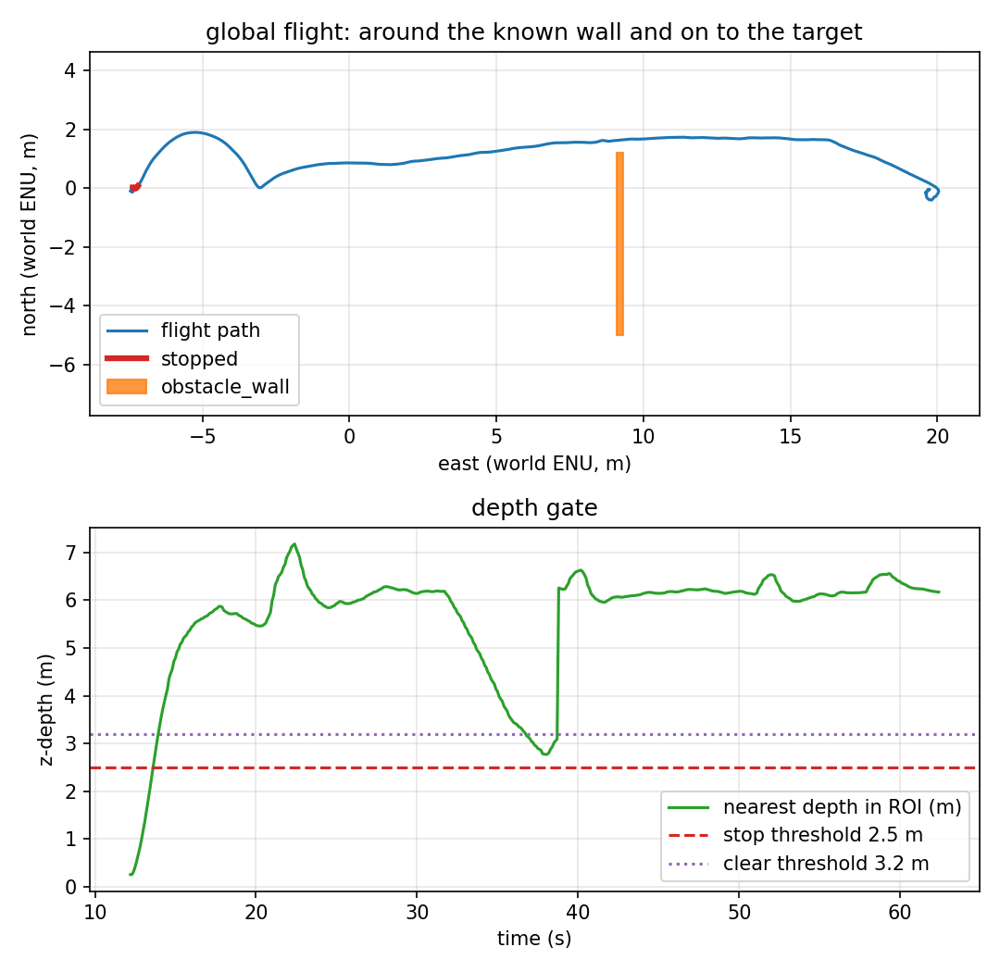

# Offset doorway, then a turn to target_1

This is the realistic version of the offset-doorway idea that failed for
target_0. The gate is moved away from the target:

- gate at world x = 9.2, 2.4 m gap centred at y = 2.4,
- target_1 at world (20, 0), far east of the gate.

The vehicle must go north through the gap, then turn south and continue to
target_1. Because target_1 is 10.8 m east of the gate, the landing is not inside a
wall's propeller envelope.



## The run

`make gate-target1` gives the planner both gate segments in local ENU
(`(16.7, -1.9)` 0.2 × 6.2 m and `(16.7, 4.3)` 0.2 × 1.4 m), **1.0 m inflation,
0.05 m waypoint tolerance**, and the goal is target_1 at local `(27.5, 0)`. The
report takes `--target-id 1` so the target error is measured against target_1,
not target_0.

One headless SITL flight, 2026-11-11. This is the **legacy 0.5 m / 0.2 m single
run**; it passed, but the repeat suite later showed that configuration was not
robust. Raw data:
[`results/gate_target1_run.csv`](../results/gate_target1_run.csv) (625 rows at
10 Hz), [`results/gate_target1_summary.json`](../results/gate_target1_summary.json),
[`results/gate_target1_trace.csv`](../results/gate_target1_trace.csv),
[`results/gate_target1_landing.csv`](../results/gate_target1_landing.csv).

| Metric | Value | How it is measured |
|---|---|---|
| Planned waypoints | **3** around 2 gate segments | offboard log |
| Final target error | **0.277 m** to target_1 | final CSV row |
| Landing row | **0.425 m**, target 1, `success=True`, `patrol complete` | recorder |
| Minimum clearance | **0.42 m** at t = 35.4 s | to the lower gate segment |
| Contacts | **0** on lower **and** upper segment | two contact topics |
| Depth frames | 822 (≈15 Hz) | recorder |
| Flight duration | 62.4 s | CSV |

Report: `scripts/avoidance_report.py --mode global --target-id 1` → four checks,
all PASS for this legacy run.

## Repeatability: the single run was not enough

`make repeat-target1-10` first ran this mission with the original 0.5 m / 0.2 m
configuration: **0/3 PASS**, 4 contacts, minimum clearance **0.018 m**. The path
threaded the gap too tightly and the follower cut a corner.

A 0.8 m / 0.1 m fix reached **9/10**, but one run still had a single gate contact
at 0.704 m reported clearance. The 1.0 m / 0.05 m margin then looked like
**10/10**, but expanding to **n=20 at the 70 s budget** found 4 failures: runs 15,
16 and 18 timed out without reaching target_1, and run 17 had **186 contacts** and
a 6.834 m error.

The preserved trace showed GOTO starting ~18 s after takeoff and the 70 s budget
expiring 3.85 m short of target_1 with 0 contacts. Keeping the path unchanged and
raising only `max_mission_s` to **100 s** gives **19/20**, 0 contacts, 20/20
landings, target error 0.114/0.461/2.149 m. The single failure is a **2.149 m
target miss**, not a crash or timeout. The scenario remains **⚠️ 19/20**, not
20/20. The original 0/3, the 0.8/0.1 9/10, the 70 s 16/20 and the 100 s 19/20 are
all preserved in `results/repeat/`. See
[`repeatability.md`](repeatability.md).

## What is verified, and what is not

| Claim | Status | Evidence |
|---|---|---|
| Thread an offset 2.4 m gap, then turn to a far target | ⚠️ **19/20 at 100 s** | 0 contacts, 20/20 landings, one 2.149 m target miss |
| The 70 s budget is sufficient | ❌ **not robust** | 16/20; 3 timeouts + 186-contact run |
| The 1.0/0.05 margin alone is sufficient | ❌ **not sufficient** | 70 s 16/20; the time budget was the dominant failure |
| The 0.8/0.1 configuration is robust | ⚠️ **9/10** | one contact at 0.704 m reported clearance |
| The original 0.5/0.2 configuration is robust | ❌ **not robust** | 0/3, 4 contacts, 0.018 m minimum |
| The target is far enough for a clean landing | ✅ verified | target_1 10.8 m east of gate, 0.425 m landing |
| Report target is target_1 | ✅ verified | `--target-id 1`; target_1 0.277 m |
| The gap is hand-entered | ❌ **not implemented** | two boxes in the mission |
| An offset gap before target_0 | ❌ **not viable** | target_0 would sit behind the lower segment, 0.7 m from its face (4 contacts in the attempt) |
| Very narrow / cluttered / 3-D / dynamic | ❌ **not verified** | one 2.4 m gap |

## Reproducing it

```bash
make install-world
make gate-target1
```

The mission is `config/mission_gate_target1.yaml`, world
`target_tracking_gate_target1`, prefix `gate_target1`, obstacle config
`config/gate_target1_obstacle.yaml`, target id 1. It fails if the final error is
above 1.5 m, clearance below 0.4 m, or either gate contact fires.

## Known artifacts

- The 0.42 m minimum is close to the 0.4 m gate; the path threads the gap rather
  than taking a wider route.
- `check_world_targets.py` still checks the original five worlds; this world is
  exercised by the run.
- target_0 remains in the world west of the gate but is not the mission target.
