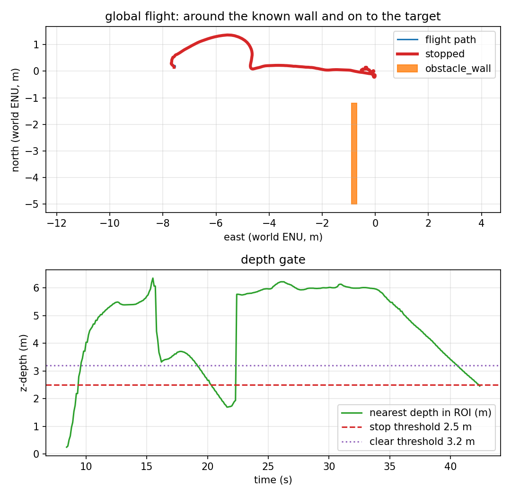

# Through the doorway and land on the target

The previous global runs landed on an east stand-off because target_0 sat 0.7 m
from a solid wall. This task is the realistic version: the wall becomes two
segments with a **2.4 m doorway**, and the vehicle flies through it to land on
target_0 itself.



## The task

`make gate` uses `target_tracking_gate.sdf`:

- two 6 m wall segments at world x = -0.8,
- lower segment y ∈ [-5.0, -1.2], upper y ∈ [1.2, 5.0],
- a 2.4 m gap at y ∈ [-1.2, 1.2],
- target_0 at the origin, directly beyond the gap.

The mission gives the planner both segments in local ENU
(`(6.7, ±3.1)`, 0.2 × 3.8 m), 0.5 m inflation, and the goal is target_0 itself
(local `(7.5, 0)`), not a stand-off. The reactive stop is disabled; this is a
planner-and-landing task.

The path is one straight waypoint through the gap. That is the correct answer:
the doorway is aligned with the target, so any detour would be longer.

## What the run measured

One headless SITL flight, 2026-11-11. Raw data:
[`results/gate_run.csv`](../results/gate_run.csv) (425 rows at 10 Hz),
[`results/gate_summary.json`](../results/gate_summary.json),
[`results/gate_trace.csv`](../results/gate_trace.csv),
[`results/gate_landing.csv`](../results/gate_landing.csv).

| Metric | Value | How it is measured |
|---|---|---|
| Planned waypoints | **1** through 2 gate segments | offboard log |
| Final target error | **0.49 m** | final CSV row |
| Landing row | **0.275 m**, `success=True`, `patrol complete` | recorder |
| Minimum clearance | **1.17 m** at t = 25.0 s | to the lower segment (the tighter one) |
| Contacts | **0** on lower **and** upper segment | two contact topics |
| Depth frames | 639 (≈15 Hz) | recorder |
| Flight duration | 42.4 s | CSV |

Report: `scripts/avoidance_report.py --mode global` → four checks, all PASS.

## What is verified, and what is not

| Claim | Status | Evidence |
|---|---|---|
| Fly through a 2.4 m doorway and land on target_0 | ✅ verified | 0.49 m final, 0.275 m landing, 0 contacts |
| Both gate segments are monitored | ✅ verified | both contact topics, 0 contacts |
| The plan clears the tighter lower segment | ✅ verified | 1.17 m |
| The doorway is hand-entered, not perceived | ❌ **not implemented** | two boxes in the mission |
| A narrower/cluttered doorway or 3-D | ❌ **not verified** | one 2.4 m aligned gap |
| Dynamic obstacles / replanning | ❌ **not implemented** | static segments |

## Reproducing it

```bash
make install-world
make gate
```

The mission is `config/mission_gate.yaml`, world `target_tracking_gate`, prefix
`gate`, obstacle config `config/gate_obstacle.yaml`. It fails if the final error
is above 1.5 m, clearance below 0.4 m, or either gate contact fires.

## Known artifacts

- `config/gate_obstacle.yaml` describes only the lower segment; the upper segment
  is covered by its contact sensor, which reported zero.
- `check_world_targets.py` still checks the original five worlds; the gate world's
  targets are the same and are exercised by this run.
- The doorway is deliberately aligned with the target, so the result verifies the
  gap traversal, not a turn inside a narrow passage.
