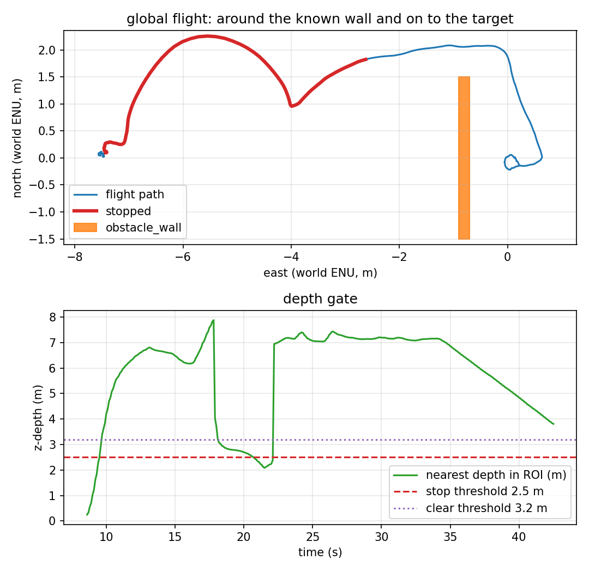

# Known-map global planning

The local avoidance stack reacts to the depth camera. Phase 9 asks the other
question: with a map of the obstacle, plan the path **before** flying it. This is
a known-map demo, not perception: the wall is in `config/obstacle.yaml`,
repeated in the mission's `global_obstacles`, and the planner reads that list.



*The path is the planned A* route (plus the final stand-off segment); the red
segments are the depth gate's `stop` flag, which is disabled for this run, not
controller holds.*

## The planner

`src/uav_tracking/planning/global_planner.py`:

1. **Grid A\*** over the local ENU bounds, 0.2 m cells.
2. **Inflated axis-aligned boxes**: any cell within `inflation_m` of a box is
   blocked. The wall is `[6.7, 0, 0.2, 3.0]` in local ENU (world `-0.8` minus
   spawn `-7.5`), inflated by 0.5 m.
3. **8-connected**, no corner cutting; Euclidean cost.
4. **Line-of-sight simplification**: greedy segments sampled every cell; the
   final point is the goal.
5. The offboard plans **once per goal**, follows the waypoints at 0.6 m/s, then
   takes the final target.

The mission plans to a stand-off at local `(8.2, 0)`, 0.7 m east of target_0:
target_0 itself is only 0.7 m from the wall face, and landing exactly on it put
the props inside the wall's contact envelope in earlier attempts. The report's
target error is measured against target_0, so 0.24 m is the delivered result.

## What the run measured

One headless SITL flight, `make global`, 2026-11-11. Raw data:
[`results/global_run.csv`](../results/global_run.csv) (426 rows at 10 Hz),
[`results/global_summary.json`](../results/global_summary.json),
[`results/global_trace.csv`](../results/global_trace.csv),
[`results/global_landing.csv`](../results/global_landing.csv).

| Metric | Value | How it is measured |
|---|---|---|
| Planned waypoints | **3** around 1 obstacle | `offboard_avoidance.log`: `global path: 3 waypoint(s)` |
| Planned map | **wall at local 6.7**, inflated 0.5 m | mission config |
| Target reached | **0.24 m** final error to target_0 | final CSV row |
| Landing row | **0.216 m**, `success=True`, `patrol complete` | recorder |
| Minimum wall clearance | **0.554 m** at t = 25.3 s | vehicle centre to the wall AABB |
| Contacts | **0** | wall contact topic |
| Depth frames | 640 (≈15 Hz) | recorder |
| Flight duration | 42.5 s | CSV |
| Reactive stop | **disabled** for this mission | `avoidance_stop_enabled: false` |

Report: `scripts/avoidance_report.py --mode global` → four checks, all PASS.

## What is verified, and what is not

| Claim | Status | Evidence |
|---|---|---|
| A* around the known wall reaches target_0's side | ✅ verified | 3 waypoints, 0.24 m final error, 0.216 m landing |
| The planned path keeps clear of the wall | ✅ verified | 0.554 m minimum clearance, 0 contacts |
| The reactive depth stop is off for this run | ✅ documented | `avoidance_stop_enabled: false`; red gate flag in the plot |
| Planning from perception | ❌ **not implemented** | the obstacle list is hand-entered; the depth camera is recorded but not used by the planner |
| Replanning while flying / dynamic obstacles | ❌ **not implemented** | one plan per goal, static boxes |
| Non-axis-aligned or 3-D obstacles | ❌ **not implemented** | 2-D axis-aligned boxes, constant altitude |
| A real depth sensor / map uncertainty | ❌ **not verified** | ideal Gazebo world and hand-entered map |

## Reproducing it

```bash
make install-world
make global
```

The target uses `config/mission_global.yaml`, world
`target_tracking_obstacle`, prefix `global`, and the wall map. It fails if the
final error is above 1.5 m, the clearance is below 0.4 m, or the wall contact
fires.

## Known artifacts

- The depth gate still publishes stop (the wall is within 2.5 m during the
  planned route), so the CSV/plot marks those samples red. The controller ignores
  them because `avoidance_stop_enabled: false`; the red is not a hold.
- The trace only records state changes and arrivals, not every path waypoint;
  the path is visible in the plot and the plan size is in the offboard log.
- The final target error is to target_0, while the mission target is the 8.2 m
  stand-off; the vehicle drifted 0.4 m west during descent, which is why the
  reported error is smaller than the stand-off distance.
