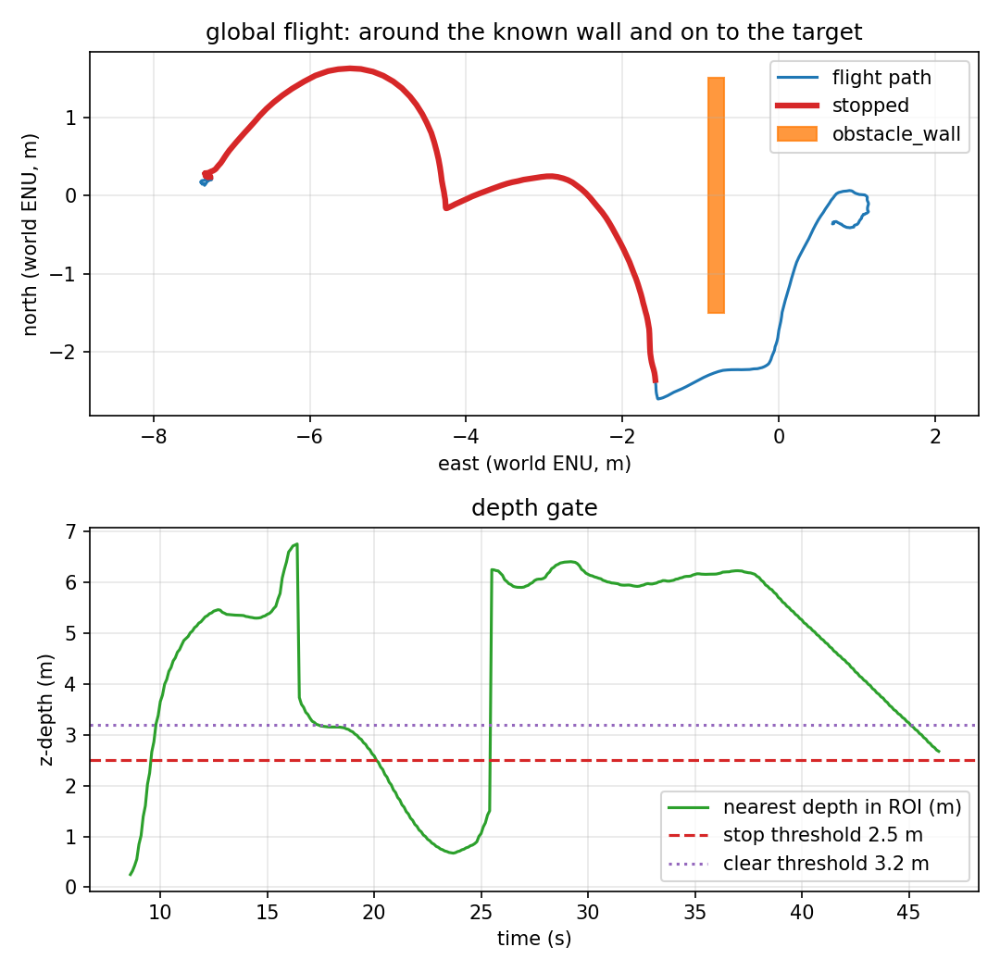

# One measured obstacle, then replan

The known-map demos hand the planner boxes. Phase 10 closes the smallest part of
that gap: the map starts **empty**, the vehicle flies toward the target, the depth
gate stops on the wall, and that measured stop becomes one conservative box that
the planner routes around.



*The stop flag is red at the wall; the blue path then goes around the box and on to
the stand-off.*

## The handoff

1. The mission starts with `global_obstacles: []`; the first plan is a straight
   waypoint to the stand-off.
2. The depth gate stops at the wall: nearest **2.46 m** in this run.
3. The offboard builds a box from `nearest_m`, the current ENU position and yaw:
   - width 4.0 m across the heading (conservative; the wall is 3 m),
   - thickness 0.4 m along it.
   The box here is `(6.57, 0.17)`, `0.40 × 4.00` m in local ENU.
4. It replans: **3 waypoints around 1 obstacle**, then ignores the reactive stop
   for the rest of the mission (`_perception_done`), because the plan is now the
   authority. The stop itself remains published; it is simply not obeyed after
   the handoff.
5. The vehicle follows the path and lands on the stand-off.

This is a one-shot **perception-to-planning** handoff, not an occupancy map: one
depth distance, one box, one replan.

## What the run measured

One headless SITL flight, `make global-perception`, 2026-11-11. Raw data:
[`results/global_perception_run.csv`](../results/global_perception_run.csv) (465
rows at 10 Hz), [`results/global_perception_summary.json`](../results/global_perception_summary.json),
[`results/global_perception_trace.csv`](../results/global_perception_trace.csv),
[`results/global_perception_landing.csv`](../results/global_perception_landing.csv).

| Metric | Value | How it is measured |
|---|---|---|
| Initial plan | **1 waypoint, 0 obstacles** | offboard log |
| Stop | at t = 20.2 s, nearest **2.46 m** | depth node + summary |
| Measured box | **(6.57, 0.17), 0.40 × 4.00 m** | offboard log |
| Replan | **3 waypoints around 1 obstacle** | offboard log |
| Final target error | **0.777 m** | final CSV row |
| Landing row | **1.13 m**, `success=True`, `patrol complete` | recorder |
| Minimum wall clearance | **0.732 m** at t = 31.4 s | vehicle centre to the wall AABB |
| Contacts | **0** | wall contact topic |
| Depth frames | 698 (≈15 Hz) | recorder |
| Flight duration | 46.4 s | CSV |

Report: `scripts/avoidance_report.py --mode global` → four checks, all PASS.

## What is verified, and what is not

| Claim | Status | Evidence |
|---|---|---|
| The first plan has no obstacle | ✅ verified | log: 1 waypoint, 0 obstacles |
| A depth stop becomes a planner box | ✅ verified | log: nearest 2.46 m → box, 3-waypoint replan |
| The replanned path reaches the target side | ✅ verified | 0.777 m target error, 0 contacts |
| The box path clears the real wall | ✅ verified | 0.732 m clearance, 0 contacts |
| A full occupancy map / multiple depth points | ❌ **not implemented** | one range, one box |
| Replanning after the handoff | ❌ **not implemented** | one replan, then follow |
| Dynamic obstacles / 3-D or rotated boxes | ❌ **not verified** | static wall, axis-aligned conservative box |
| A real depth sensor | ❌ **not verified** | ideal Gazebo float32 depth |

## Reproducing it

```bash
make install-world
make global-perception
```

The target uses `config/mission_global_perception.yaml`, world
`target_tracking_obstacle`, prefix `global_perception`, an empty initial
`global_obstacles`, and the depth stop enabled only until the handoff. It fails
if the final error is above 1.5 m, the clearance is below 0.4 m, or the wall
contact fires.

## Known artifacts

- The 2.46 m is the depth **z** value along the optical axis, not a horizontal
  range; it is used as the along-heading distance for the conservative box. The
  box still covered the wall because it is 4 m wide and 0.4 m thick.
- The box's y centre is 0.17 m, from the vehicle's lateral offset at the stop, not
  from a measured wall centre.
- The reactive stop is ignored **after** the handoff. If the replanned path were
  wrong, this mission would not have the local safety net; the clearance and
  contact checks are the guard.
