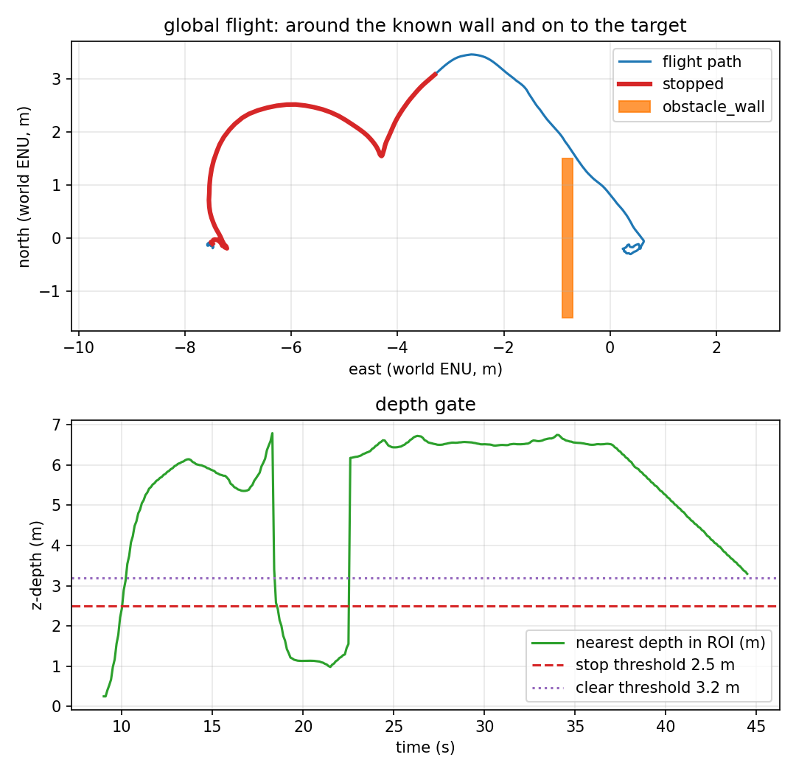

# Two rotated obstacles

Phase 12 gives the same A* two rotated boxes at once:

```text
[6.70, 0.0, 0.20, 3.00, 0.5236]   # 30-degree wall
[5.00, 2.0, 0.80, 0.80, 0.7854]   # 45-degree pillar
```

`target_tracking_rotated_multi.sdf` copies the rotated world and adds the pillar,
with its own contact sensor. The planner finds **3 waypoints around 2 obstacles**;
the report still measures the exact rotated wall distance, and the recorder counts
both contact topics.



## What the run measured

One headless SITL flight, 2026-11-11. Raw data:
[`results/global_rotated_multi_run.csv`](../results/global_rotated_multi_run.csv)
(437 rows at 10 Hz),
[`results/global_rotated_multi_summary.json`](../results/global_rotated_multi_summary.json),
[`results/global_rotated_multi_trace.csv`](../results/global_rotated_multi_trace.csv),
[`results/global_rotated_multi_landing.csv`](../results/global_rotated_multi_landing.csv).

| Metric | Value | How it is measured |
|---|---|---|
| Planned waypoints | **3** around 2 rotated obstacles | offboard log |
| Final target error | **0.586 m** | final CSV row |
| Landing row | **0.439 m**, `success=True`, `patrol complete` | recorder |
| Minimum wall clearance | **0.698 m** at t = 37.5 s | exact rotated wall distance |
| Contacts | **0** on wall **and** pillar | two contact topics |
| Depth frames | 664 (≈15 Hz) | recorder |
| Flight duration | 43.6 s | CSV |

Report: `scripts/avoidance_report.py --mode global` → four checks, all PASS.

## What is verified, and what is not

| Claim | Status | Evidence |
|---|---|---|
| A* routes around two rotated boxes | ✅ verified | 3 waypoints, 0.586 m target, 0 contacts |
| The pillar contact sensor is counted | ✅ verified | run log lists both contact topics, 0 contacts |
| The exact rotated wall clearance is reported | ✅ verified | 0.698 m |
| Many rotated boxes / arbitrary polygons | ❌ **not verified** | two boxes only |
| Perception of either obstacle | ❌ **not implemented** | both hand-entered |
| Dynamics / replanning / 3-D | ❌ **not implemented** | static, constant altitude |

## Reproducing it

```bash
make install-world
make global-rotated-multi
```

The mission is `config/mission_global_rotated_multi.yaml`; world
`target_tracking_rotated_multi`; prefix `global_rotated_multi`; obstacle config
`config/rotated_obstacle.yaml`. It fails if the final error is above 1.5 m,
clearance below 0.4 m, or either contact fires.

## Known artifacts

- The pillar is not included in the report's clearance metric (that metric is the
  wall's); the pillar is covered by its contact sensor, which reported zero.
- `check_world_targets.py` still checks the original five worlds; this world is
  exercised by the run.
- The landing point is the same 0.7 m east stand-off, not target_0 itself.
