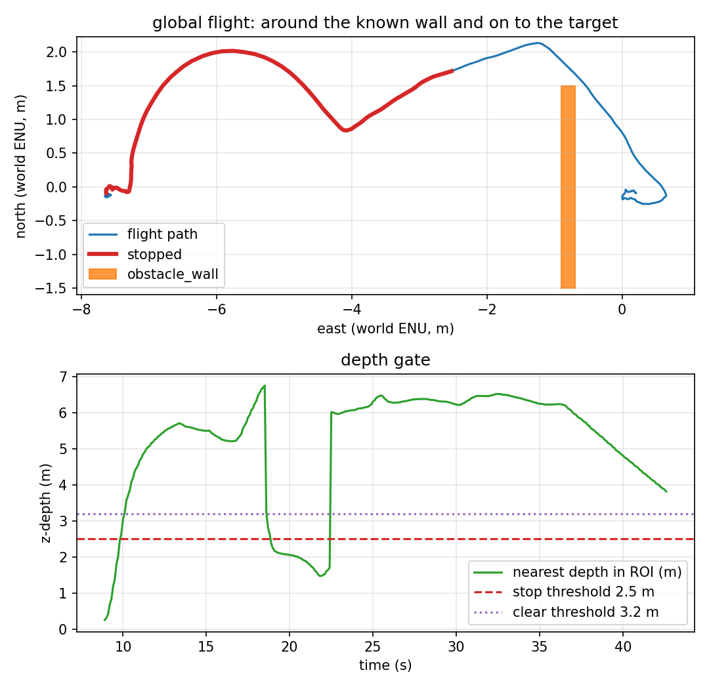

# Rotated-box global planning

The earlier known-map demos used axis-aligned boxes. Phase 11 lets an obstacle be
rotated about z: `Box` gains a fifth field, `angle_rad`, and
`Box.contains()` rotates the query point into the box frame. The planner itself
is unchanged; its grid, inflation and line-of-sight check all use the rotated
test.



## The run

`make global-rotated` uses `target_tracking_rotated.sdf`: the same 6 m wall,
rotated 30° about z. The mission passes one rotated box in local ENU:

```text
[6.70, 0.0, 0.20, 3.00, 0.5236]   # x, y, thickness, length, yaw
```

The planner finds **2 waypoints around 1 obstacle**. The report measures the
exact rotated distance (not an axis-aligned bound), using the wall's real
`0.2 × 3.0 m` size and 30° angle.

One headless SITL flight, 2026-11-11. Raw data:
[`results/global_rotated_run.csv`](../results/global_rotated_run.csv) (427 rows
at 10 Hz), [`results/global_rotated_summary.json`](../results/global_rotated_summary.json),
[`results/global_rotated_trace.csv`](../results/global_rotated_trace.csv),
[`results/global_rotated_landing.csv`](../results/global_rotated_landing.csv).

| Metric | Value | How it is measured |
|---|---|---|
| Planned waypoints | **2** around 1 rotated obstacle | offboard log |
| Obstacle | wall at 30°, `0.2 × 3.0 m` | world + mission |
| Final target error | **0.218 m** | final CSV row |
| Landing row | **0.391 m**, `success=True`, `patrol complete` | recorder |
| Minimum wall clearance | **0.509 m** at t = 37.4 s | exact rotated point-to-box distance |
| Contacts | **0** | rotated world's wall contact topic |
| Depth frames | 580 (≈15 Hz) | recorder |
| Flight duration | 42.6 s | CSV |

Report: `scripts/avoidance_report.py --mode global` → four checks, all PASS.

## What is verified, and what is not

| Claim | Status | Evidence |
|---|---|---|
| A* routes around a box rotated 30° | ✅ verified | 2 waypoints, 0.218 m target, 0 contacts |
| The clearance is measured against the rotated shape | ✅ verified | exact rotated distance, 0.509 m |
| The planner handles non-axis-aligned 2-D obstacles | ✅ verified for one static box | this run |
| Multiple rotated boxes / 3-D obstacles | ❌ **not verified** | one box, constant altitude |
| Perception of a rotated obstacle | ❌ **not implemented** | the box is hand-entered |
| Dynamics / replanning | ❌ **not implemented** | one plan, static wall |

## Reproducing it

```bash
make install-world
make global-rotated
```

The mission uses `config/mission_global_rotated.yaml`, world
`target_tracking_rotated`, prefix `global_rotated`, and the exact rotated wall
config `config/rotated_obstacle.yaml`. It fails if the final error is above
1.5 m, clearance below 0.4 m, or the wall contact fires.

## Known artifacts

- The world file is a copy of the obstacle world with the wall yaw and world name
  changed; its target poses are the same.
- `check_world_targets.py` still checks the original five worlds; the rotated
  world is exercised by this run, not by that static check.
- The vehicle still lands on the 0.7 m east stand-off, not target_0 itself, for
  the same propeller-clearance reason as the earlier global demos.
