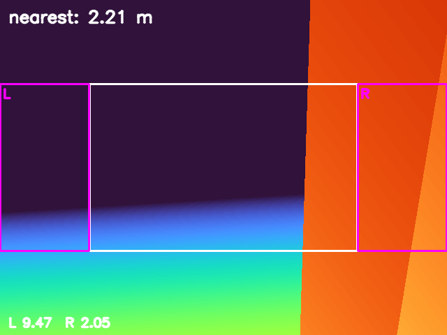

# Side-stepping after a blocked stop

Phase 7 sized the retreat. Phase 8 adds the other local degree of freedom: when a
stop is still blocked after the back-off, **shift sideways** toward the freer side
and re-read the strips. It is bounded by `search_max_attempts`; if no side
appears, it holds.



*The diagnostic overlay drawn by the recorder: the left 20% strip (L) and right
20% strip (R) at the stop. `L 9.47`, `R 2.05`: only the right strip sees the
obstacle. This is the honest caveat below.*

## The sequence

1. The gate stops. A `blocked` label arrives during the settle (0.7 s after the
   stop here); the controller latches it and starts the side search.
2. The search side is the one with the larger measured clearance. The planner
   sets a waypoint `search_step_m` (2 m) sideways and re-reads on arrival.
3. If a side is free, the normal lateral leg starts from the searched position.
   If not, another step is taken up to `search_max_attempts`; then it holds.
4. The lateral leg, forward leg and target resume are unchanged.

## The scenario

`make search` uses `target_tracking_search.sdf`: the phase-1 wall plus two
0.8 × 0.8 × 6.0 m pillars at `(-1.5, ±1.5)`, with their own contact sensors, and
a 4.0 m side floor. The mission is
[`config/mission_search.yaml`](../config/mission_search.yaml):
`search_step_m: 2.0`, `search_max_attempts: 2`, no back-off, forward leg 7.5 m.

## What the run measured

One headless SITL flight, `make search`, 2026-11-11. Raw data:
[`results/search_run.csv`](../results/search_run.csv) (745 rows at 10 Hz),
[`results/search_summary.json`](../results/search_summary.json),
[`results/search_trace.csv`](../results/search_trace.csv),
[`results/search_landing.csv`](../results/search_landing.csv),
[`results/search_depth_frame.npy`](../results/search_depth_frame.npy).

| Metric | Value | How it is measured |
|---|---|---|
| Stop engaged | **yes**, at t = 17.9 s | first `stop=1` row |
| Side clearances at the stop | **left 9.47 m, right 2.05 m** | `left_m`, `right_m`; the overlay frame |
| Depth label | `left` at the stop, **`blocked` 0.7 s later** | `depth_node.log` |
| Search | **`side-search right`** → `search found a side: lateral leg` | trace |
| Search step | **2.1 m** (y 0.03 → −2.11) | trace positions |
| Lateral leg after it | **3.0 m** (y −2.11 → −5.13) | trace |
| Max lateral excursion | **5.317 m** | path |
| Forward leg | **7.5 m** | mission config |
| Gate released | **yes** | report |
| Final target error | **0.537 m** | final CSV row |
| Landing row | **0.652 m**, `success=True`, `patrol complete` | recorder |
| Minimum wall clearance | **1.221 m** | vehicle centre to the wall AABB |
| Contacts (wall + pillars) | **0** | both contact topics |
| Depth frames | 1072 (≈15 Hz) | recorder |
| Flight duration | 74.4 s | CSV |

Report: `scripts/avoidance_report.py --mode detour` → eight checks, all PASS.

## What this does and does not prove

| Claim | Status | Evidence |
|---|---|---|
| The side search executes and re-reads | ✅ verified | trace `side-search right` → `search found a side` |
| It recovers to target_0 after the search | ✅ verified | 0.537 m final error, 0.652 m landing, 8/8 checks |
| It does not touch the wall or pillars | ✅ verified | 0 contacts, 1.221 m clearance |
| **Both strips were simultaneously below the floor at the stop** | ❌ **not proven** | the stop frame has L 9.47 / R 2.05; the `blocked` label that started the search came 0.7 s after the stop |
| A search with both strips genuinely blocked | ❌ **not verified** | needs a geometry where both strips stay inside the floor at the stop |
| Alternating the search direction / a 2-D map | ❌ **not implemented** | one side, fixed step, bounded attempts |
| Multiple obstacles / dynamic / global planning | ❌ **not verified** | one static wall + two pillars |

**The caveat is the important part of this page.** The retained run verifies the
SEARCH transition, the side-step and the recovery, but the trigger was a latched
`blocked` after the stop, not a frame with both strips below the floor. The
overlay frame is included so that this is visible rather than hidden.

## Reproducing it

```bash
make install-world
make search
```

The target uses `config/mission_search.yaml`, world
`target_tracking_search`, prefix `search`, `config/depth_search.yaml` and the
two-pillar world. It fails if the stop does not happen, the target is not
reached, the clearance is below 0.4 m, or any contact sensor fires.

## Known artifacts

- The stop frame's left strip reads 9.47 m because the left pillar at +1.5 m is
  outside that strip's view; only the right strip sees a pillar. The search still
  works, but it is not the both-blocked scenario it was meant to be.
- The search side was `right` even though the stop frame's left strip was the
  more open one; the side-clearance values changed between the stop and the
  search start as the vehicle pitched. The choice is made from the latest topic
  values, not from the frame.
- The first stop event in `depth_node.log` (nearest 0.25 m) is the ground during
  takeoff; the controller is in `TAKEOFF` and ignores it.
