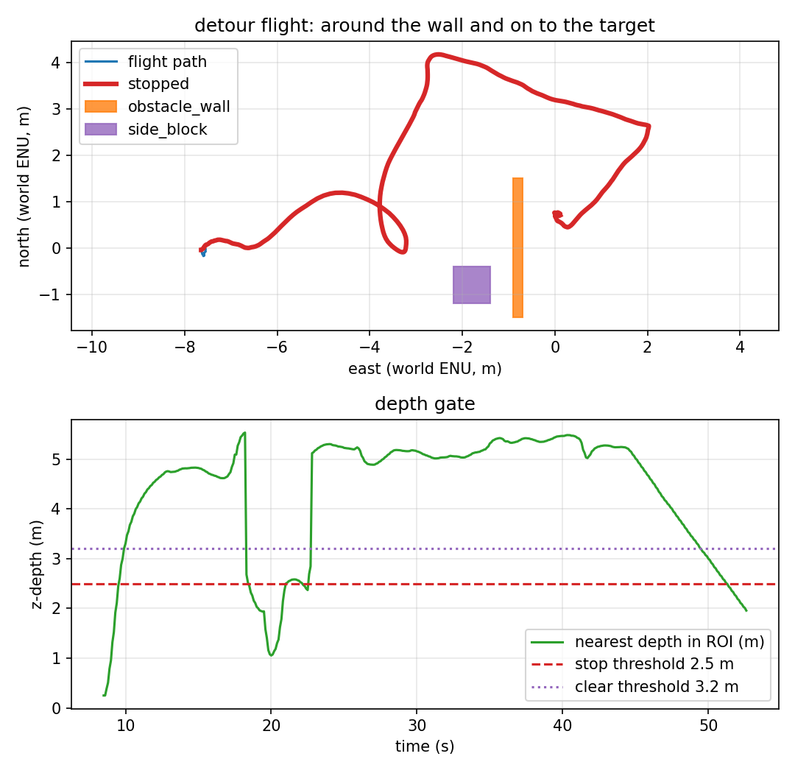

# Choosing the side: depth strips instead of a constant

Phase 2 always detoured right. Phase 3 is the smallest version of "look before
you pick": the depth node measures the nearest return in a left and a right
strip outside the centre ROI, publishes which side is freer, and the detour
planner uses that side at the moment it starts. **It is not a planner**: one
obstacle, one binary choice, no memory, no map. Phase 4 adds the refusal when
both strips are inside the clearance floor; see [`blocked.md`](blocked.md).



*The pillar (purple) sits in the right strip. The vehicle stops at the wall, flies
left/north, forward past the wall, and reaches target_0. The red segment is still
the stop flag, which stays set during the escape.*

## How the choice is made

Pure functions in [`src/uav_tracking/perception/depth.py`](../src/uav_tracking/perception/depth.py):

1. **Two strips.** The left 20% and right 20% of the image width, over the same
   central 50% height band as the stop ROI. They are deliberately outside the
   centre 60%: the centre sees the wall that already stopped the vehicle, and it
   would make both sides look equally blocked.
2. **Nearest return per strip.** The same validity rules as the stop gate: finite,
   above `min_valid_m`, at most `max_valid_m`. A missing return means open space
   (beyond 12 m), not an unknown obstacle.
3. **Margin.** If the two sides differ by less than `side_margin_m` (0.5 m), the
   fallback side wins instead of flipping on noise. `unknown` (no return on either
   side) also falls back.
4. **Publication.** `/avoidance/clear_side` (`std_msgs/String`) is published at
   10 Hz with `left`, `right` or `unknown`, alongside `/avoidance/stop` and
   `/avoidance/nearest_m`.
5. **Use.** `detour_auto_side: true` makes `offboard_node` pass the value to the
   planner when a detour starts. `detour_side` is the fallback. The planner stores
   the side in its decision and the trace; the recorder writes it per row.

The decision is taken **once**, at the first stopped tick. The whole-run majority
is not the decision: after the vehicle is around the wall, the free side often
flips. `results/autod_summary.json` shows both (`clear_side_at_stop=left`,
whole-run mode `right`) and the report checks the former.

## The scenario

`sim/worlds/target_tracking_detour.sdf` is `target_tracking_obstacle.sdf` plus a
0.8 × 0.8 × 6.0 m pillar at world `(-1.8, -0.8)`, clear of the wall by 0.5 m so
the two static bodies do not overlap. At the stop the right strip sees the pillar
and the left strip sees the wall's north edge farther away; the difference is
above the 0.5 m margin, so the expected side is **left**.

The pillar has its own contact sensor; the recorder subscribes to both contact
topics, so "0 contacts" covers the wall and the side the vehicle did not take.

## What the run measured

One headless SITL flight, `make auto-detour`, 2026-11-11. Spawn `(-7.5, 0, 0.05)`
facing east; approach 0.6 m/s. Raw data:
[`results/autod_run.csv`](../results/autod_run.csv) (518 rows at 10 Hz),
[`results/autod_summary.json`](../results/autod_summary.json),
[`results/autod_trace.csv`](../results/autod_trace.csv),
[`results/autod_landing.csv`](../results/autod_landing.csv).

| Metric | Value | How it is measured |
|---|---|---|
| Stop engaged | **yes**, at t = 18.5 s | first `stop=1` row |
| Side at the stop | **left** | `clear_side` on the first stopped row |
| Lateral leg | **4.181 m** max north | path; side block is south |
| Gate released | **yes**, at t = 22.7 s | first `stop=0` after the stop |
| Target reached | **0.714 m** final error | final CSV position vs target_0 |
| Landing row | **0.591 m**, `success=True`, `patrol complete` | recorder |
| Minimum wall clearance | **0.688 m** (at t = 46.8 s) | vehicle centre to the wall AABB |
| Contacts (wall + pillar) | **0** | both `gz.msgs.Contacts` topics |
| Depth frames | 790 (≈15 Hz) | recorder |
| Flight duration | 51.7 s | CSV |

Report: `scripts/avoidance_report.py --mode detour --expect-side left
--side-obstacle config/side_obstacle.yaml` → ten checks, all PASS.

## Reproducing it

```bash
make install-world      # includes target_tracking_detour.sdf
make auto-detour
```

The target uses `config/mission_detour_auto.yaml`, world
`target_tracking_detour`, prefix `autod`, and expects `left`; the report fails if
the side label, the lateral direction, the target, the clearance or the contact
count is wrong.

## What is verified, and what is not

| Claim | Status | Evidence |
|---|---|---|
| The depth node picks the freer of two strips | ✅ verified | `tests/test_depth.py` + `tests/ros/test_depth_node.py` + `clear_side_at_stop=left` |
| The planner uses the chosen side | ✅ verified | trace says "to the left"; max north 4.181 m; ten-check PASS |
| The chosen side reaches target_0 without contact | ✅ verified | 0.714 m final error, 0 contacts |
| Choosing a side when both are blocked | ✅ **holds** (phase 4) | `blocked` label + latch; see [`blocked.md`](blocked.md) |
| More than two strips / a real field of view | ❌ **not implemented** | one left and one right strip, ±22–34° |
| Remembering the choice / re-planning | ❌ **not implemented** | one decision per stop; the whole-run mode can differ |
| Dynamic obstacles, multiple obstacles, global planning | ❌ **not implemented** | one wall + one static pillar |
| A real depth sensor | ❌ **not verified** | ideal Gazebo float32 depth |

## Known artifacts

- The first stop event in `depth_node.log` (nearest 0.25 m) is the ground inside
  the near clip during takeoff; the controller is in `TAKEOFF` and ignores it.
- The `clear_side` topic can say `right` for most of the flight and `left` at the
  stop. That is why the report reads the value at the first stopped row, not the
  mode.
- The stop flag stays true during the lateral and forward legs; `stop_hold_s` is
  4.2 s and is not a "held in place" claim.
